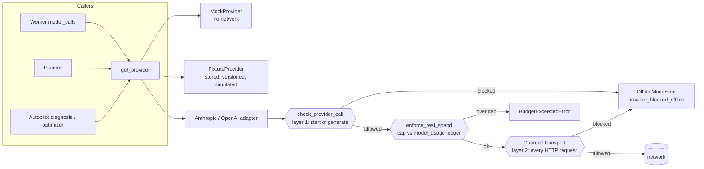
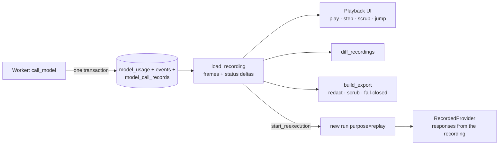
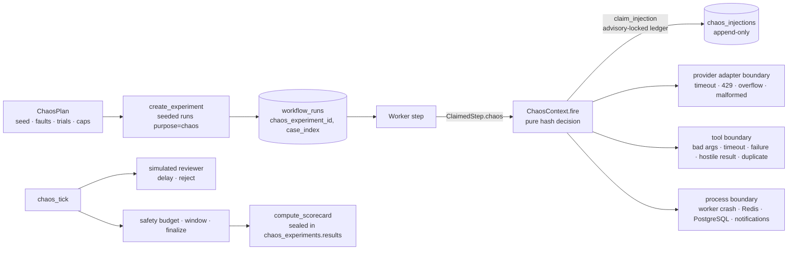
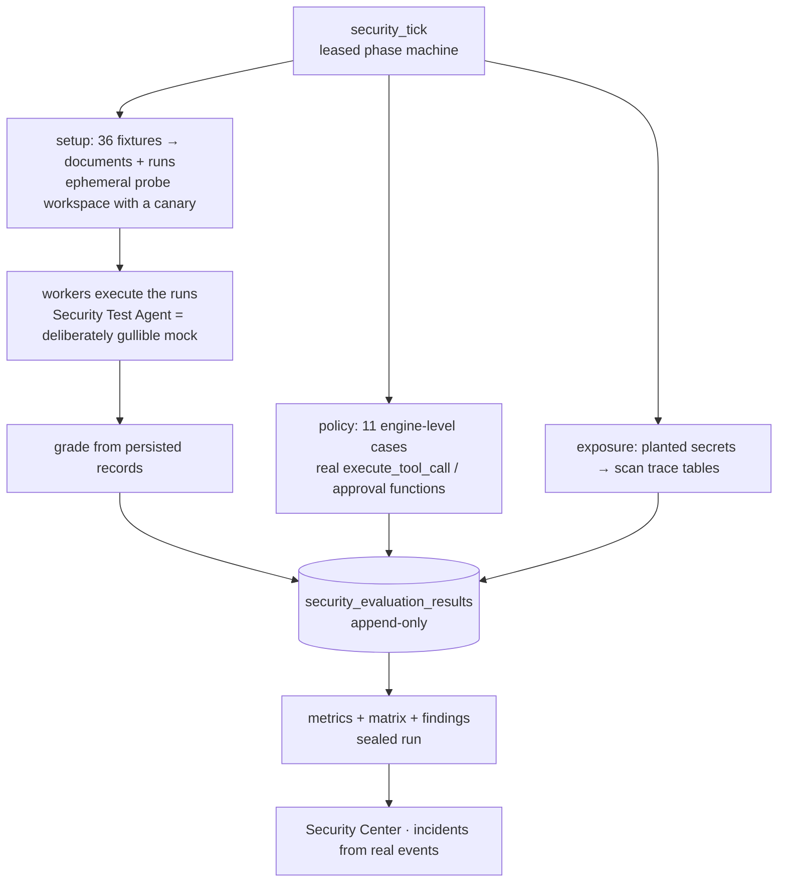
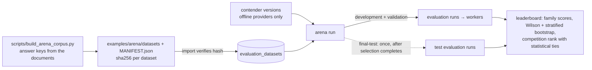
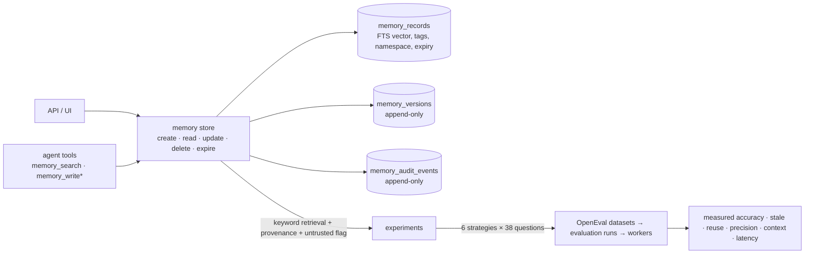
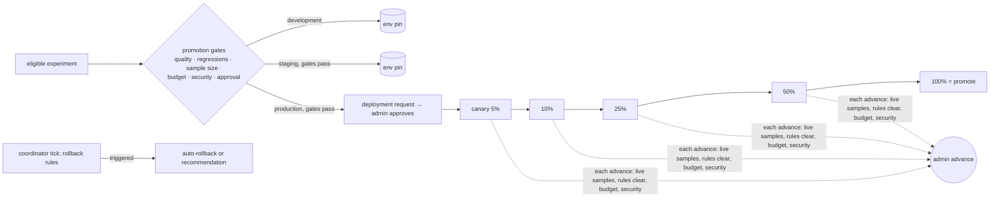

# AgentOS 2.0: architecture

This document grows phase by phase and describes only what exists in the repository. The 1.x system
(durable engine, agent runtime, Autopilot) is described in `docs/architecture.md` and
`AUTOPILOT_ARCHITECTURE.md`; this file covers 2.0 additions. Audit and plan: `docs/AGENTOS_2_AUDIT.md`.

## 1. Offline execution boundary (Phase 1)

Every model request in the system ends in a provider adapter's `generate()`. Paid providers are blocked
in code unless the execution policy allows them; no configuration document is relied upon.

* **Policy** (`ExecutionPolicy`): live requires `AGENTOS_EXECUTION_MODE=live`,
  `AGENTOS_ALLOW_PAID_PROVIDERS=true`, `AGENTOS_ENABLE_NETWORK_MODEL_REQUESTS=true` and
  `AGENTOS_MAX_REAL_API_SPEND_USD>0`. The error lists exactly which conditions fail.
* **Two independent layers.** (1) The adapter checks before building a request. (2) The real SDK clients are
  created with `GuardedTransport`, which re-checks per HTTP request, so `provider.client.messages.create()`
  called directly cannot connect either.
* **In-memory contract transports** (`httpx2.MockTransport`) are recognized and allowed offline, because they
  cannot reach the network; this keeps the SDK request/response contract tests runnable without credentials.
* **No silent fallback.** A refused or failed real-provider call fails the attempt with a typed error
  (`provider_blocked_offline` is permanent: no retry) and is recorded in `model_usage` under the *real*
  provider's name with status `failed`. The mock is never substituted.
* **Spend ledger.** `real_spend_usd()` sums recorded estimated cost for `anthropic`/`openai`;
  `enforce_real_spend()` runs inside the worker's model-call path and Autopilot's LLM wrapper, inside the
  `try` that records failed calls, so a refusal releases its budget reservation like any provider failure.
* **Fixture provider** (`providers/fixtures.py`, files in `fixtures/model_responses/*.v<N>.json`): replays
  stored responses selected by exact request digest, by substring rules, or by explicit `fixture_id`. Sets must
  declare `simulated: true`; a missing fixture raises `fixture_missing`; responses are priced with a simulated
  price (`fixture/*`) and labeled `fixture:<set>@v<N>`. `fixture_entry()` records a sanitized (redacted)
  response keyed by digest for use when real calls are enabled later.
* **Visibility.** `/api/v1/system` returns `execution` (mode, blockers, label); the header banner always shows
  `Offline: paid providers blocked` or `LIVE: paid providers enabled`, and marks keys present as blocked.
* **Migration `0003`** widens the agent provider check constraint to allow `fixture`.

What this does *not* guarantee: it controls AgentOS's model-request paths. It is not a network sandbox for
arbitrary code, and a modified build could remove the guard.

## 2. Execution engine v2 (Phase 2)

The durable engine (PostgreSQL state, `SKIP LOCKED` claims, lease tokens, fenced writes, heartbeats, retry
scheduling, immutable attempt history, idempotency keys) is unchanged. Phase 2 adds constructs on top of it,
none of which weakens those guarantees. Migration `0004`.

### 2.1 New workflow constructs

| Construct | Definition | Engine behavior |
|---|---|---|
| **Conditional branch** | any node: `when: {ref, op, value}` | Evaluated by the engine when all dependencies are terminal, against `input.*` or a declared dependency's output. False → the step is **skipped** (`step.skipped`, reason `condition_false`). An unresolvable ref or a type error is false, never an exception. 11 operators (`eq ne gt gte lt lte in not_in contains exists truthy`) |
| **Skip propagation / joins** | `trigger: all_succeeded` (default) or `any_succeeded` | A step with a skipped dependency is skipped (`upstream_skipped`) unless `any_succeeded` and at least one dependency succeeded. Skipped steps are never claimed and have no output. A step whose dependents were all skipped is reported as a run output |
| **Bounded fan-out / fan-in** | `type: fan_out`, `over` (ref to a list), `template` (an `agent_task` or `tool_task`), `max_items` ≤ 20, `on_overflow: fail\|truncate` | Never claimed by a worker. When ready, the engine creates `key[0..n-1]` child steps (each depends on the fan_out node's own dependencies, so they run in parallel) and moves the node to `waiting_child`. When every child has succeeded the node succeeds with `{"results": [...in input order], "count": n}`, so downstream nodes depend on it as a normal fan-in. More than `max_items` fails the node (default) or truncates (explicit). Expansion beyond `max_dag_nodes` fails. List items are data: they are exposed as `item`/`index` and never template-resolved |
| **Nested workflow** | `type: sub_workflow`, `workflow` (name), `input` | The engine starts the *latest version* of that workflow as a **child run** (`parent_run_id`, `parent_step_id`, `depth`) and moves the step to `waiting_child`. The child inherits the parent's priority, a deadline no later than the parent's, and a cost cap equal to the parent's remaining budget. When the child finishes, the coordinator's `subflow_tick` completes the parent step with `{"child_run_id", "output"}` (or fails it with `reason: child_failed`) and adds the child's spend to the parent. Depth limit `AGENTOS_MAX_NESTED_DEPTH` (default 3) |
| **Priority** | run `priority` 0–9 (`POST /workflows/{id}/runs {"priority": n}`) | Runs are claimed in order of *effective priority* = priority + (run age ÷ `AGENTOS_PRIORITY_AGING_SECONDS`, default 30). A priority-0 run that is 9 intervals older than a newly created priority-9 run outranks it, so low-priority work cannot be starved by later arrivals. (Runs created together age together and keep their gap.) Age is measured from run creation: a first version aged the *next ready step*, which restarts every time a multi-step run advances, and a benchmark showed it starving low-priority runs once per step |
| **Pause / resume** | `POST /runs/{id}/pause`, `/resume` (developer+) | A paused run (and its child runs) claims no new step; running steps finish; state, retries and approvals are untouched; the run deadline keeps ticking. Idempotent |
| **Cancellation** | existing | Now also cancels `waiting_child` steps and, parent→child, the child runs |

`waiting_child` is a step state without a lease: it is durable, visible in the DB and UI, and recovered by the
coordinator, not by a process. State machine additions: `PENDING → {FAILED, SUCCEEDED, WAITING_CHILD}` (engine-internal)
and `WAITING_CHILD → {SUCCEEDED, FAILED, CANCELLED}`.

**Lock order** is unchanged and deadlock-free by construction: parent run row before child run row; a child's own
transactions never lock the parent. Child→parent propagation is therefore a separate coordinator transaction
(`subflow_tick`, skip-locked, idempotent), so a crash between "child finished" and "parent updated" only delays the
parent by one tick.

### 2.2 Delivery semantics (precise)

* **Steps run at least once** while retryable: a step whose worker dies (lease expiry) is run again; the
  attempt history records `lease_expired` + the new attempt. It is **not** exactly-once for arbitrary external
  effects, and AgentOS does not claim that.
* **A completed step is never run again.** Recovery only touches `running` steps whose lease expired.
* **Stale writers are fenced.** Every completion/failure/checkpoint checks the current lease token; a worker that
  lost its lease cannot overwrite the new result (the late result is recorded as `stale` and discarded).
* **Side effects.** Every tool call carries an idempotency key (run/step scope + tool name + canonical argument
  hash), and the database allows at most one *successful* execution per key. A retried step that repeats a call
  with a recorded success gets the stored result back (marked `idempotent_replay`) instead of executing again;
  the artifact writer is additionally content-addressed and approval-gated. The remaining window is a crash
  *between* an external effect and the row that records it: a tool that cannot make its effect idempotent could
  repeat there, which is why at-least-once is the stated guarantee.
* **Engine-handled nodes** (`fan_out`, `sub_workflow`) have no worker and no lease; their transitions happen inside
  the transaction that holds the run lock, or in `subflow_tick`, so there is nothing to "execute twice".
* **Approvals** are rows; a pending approval survives any process death and is bound to its argument hash.
* The system converges: every non-terminal state has a recovery path (lease expiry, retry promotion, approval
  expiry, deadline enforcement, child propagation), so each run reaches a terminal state or is bounded by its deadline.

### 2.3 Verification

Unit tests for conditions and definition validation (`test_dag_v2.py`); integration tests for every construct on
real PostgreSQL with in-process workers (`test_engine_v2.py`); fault-injection tests with **real worker
processes** killed mid-step (`test_engine_v2_recovery.py`): a crash inside a child run, a crash after fan-out
children completed (children not re-run), SIGKILL while four fan-out children were running (each recovered once,
no duplicate children), and a pending approval surviving a killed worker. Results: `AGENTOS_2_TEST_RESULTS.md`.
Measurements: `AGENTOS_2_BENCHMARKS.md`.

## 3. Agent Flight Recorder (Phase 3)

Migration `0005`. The Flight Recorder lets a developer see exactly what an agent run did, step through it, compare it
with another run, re-execute it deterministically, and attach a sanitized trace to a bug report.

**What is captured.** For every model call, in the same transaction as its usage row and its event, an immutable
`model_call_records` row: sanitized request (system prompt, messages, tool names and descriptions, model
configuration, agent version id, prompt digest), response (text, tool calls with arguments, finish reason, usage),
latency, error, and a `request_digest` computed over the *unsanitized* request so divergence is detected exactly.
Secrets are redacted before storage; provider-raw payloads (thinking blocks, signatures) are never stored; oversize
requests keep the first and last messages and set `truncated`. A database trigger forbids UPDATE and DELETE.
Events additionally carry `trace_id` and now `span_id`, and each `model.call.*` event carries its `record_id`.

**Recorded replay** (`GET /runs/{id}/flight`) is a pure read over stored rows. A recording is a list of *frames*, one
per event in sequence order, each with the step-status changes it caused (`status_delta`), a severity
(`info|warning|error`) and trace/span ids, plus step attempts, model calls, tool executions and approvals. An
`integrity` block reports event count, first/last sequence, contiguity, gaps and a SHA-256 over the frames. The UI
applies deltas cumulatively, so scrubbing to any frame shows exactly the recorded state; tests assert that the state
after the last frame equals the final step statuses and that the state before the first frame is all `pending`.

**Deterministic re-execution** (`POST /runs/{id}/reexecute`, developer+) creates a **new** run, never touching the
recording. The run has `purpose='replay'` and `replay_of_run_id`, the same workflow version and input, and every agent
step pinned to the exact agent version the original used. In the worker:

| Aspect | Re-execution behavior |
|---|---|
| Model calls | `RecordedProvider` serves the i-th successful recorded response of the same node; no provider, no network, no cost. More calls than recorded → `replay_diverged` (permanent failure). A call whose request digest differs from the recording is still answered but flagged `request_matches_recording: false` in its event |
| Tools | only `calculator`, `document_search`, `structured_data_reader`. For agents the tool list shrinks and any other call is denied by the normal tool policy (`tool.denied`); a `tool_task` for any other tool fails with a policy violation |
| Approvals | `approval_gate` nodes complete immediately as `not_requested_in_replay`; nothing gated is ever executed or requested |
| Visibility | replay runs are tagged and filterable (`?purpose=replay`); the UI labels them and links to the original |

"Isolated test workspace" is implemented as *side-effect isolation* (purpose tag + the rules above), not as a separate
workspace, because agents and workflow definitions are workspace-scoped and copying them would change what is being
tested. This is a documented deviation from the original wording.

**Run comparison** (`GET /flight/compare?a=&b=`) aligns steps by node key and reports, per step: status, branch
(skipped in one run only), retries (failed attempts, not approval resumes), output differences as JSON paths, model
calls (request same? response same?, text snippets), and tool calls as `(tool, argument hash, status)` so a refused call
differs from an executed one; plus run-level status, output, duration, estimated cost, call counts and, for
evaluation-case runs, the pass/fail verdicts (never expected answers).

**Export** (`GET /runs/{id}/export`, developer+) builds a package of the recording and the model call bodies, removes
credential-like keys and lease tokens, redacts secret patterns, then **re-scans the result and refuses to emit it** if
anything credential-like remains (`409 export_refused`). The package carries SHA-256 hashes of the frames and itself.

**Determinism finding.** The first re-execution revealed that the task prompt for a step with several upstream
dependencies depended on database row order (`dependency_outputs` came from an unordered query), so the *same* workflow
could send a differently ordered prompt on each run. Dependencies are now assembled in declared order.

## 4. Agent Chaos Lab (Phase 4)

Migration `0006`. The Chaos Lab tests reliability, not error-message rendering: each fault is injected at the boundary where
production code meets the outside world, so the platform's own retry, policy, fencing, budget and recovery logic is
what answers it.

**Faults (17) and where they are injected**

| Boundary | Faults | How the platform sees it |
|---|---|---|
| Provider call (`call_model`, inside the failure-recording `try`) | `provider_timeout`, `provider_rate_limit`, `context_overflow` | The real typed provider errors (`ProviderTimeoutError`, `ProviderRateLimitError`, `ProviderRequestError`), so classification, retry/backoff, budget settlement and the failed-call record all run for real |
| Model response | `malformed_model_response`, `corrupted_fixture_response` | The response text is truncated / replaced and tool arguments mangled after the call; the output contract and the repair turn must catch it |
| Tool execution (`tools/runner`) | `invalid_tool_arguments` (before validation), `tool_timeout` (outlives `wait_for`), `tool_failure`, `malicious_tool_result` (injected instruction in the result), `duplicate_delivery` (the call is delivered again; the repeat has faults off) | Real schema validation, real timeout path, real policy denial, real idempotency replay |
| Step completion | `duplicate_delivery` (`after_complete`) | `complete_step` is called a second time with the same lease token; the fence must reject it |
| Worker process | `worker_crash` (`os._exit(137)` at step start / before a model call / after a tool) | Lease expiry and resumption from the checkpoint (needs real worker processes) |
| Redis | `redis_interruption` (all connections dropped, new ones refused for a window), `delayed_notifications` (publishes delayed randomly, so out of order) | Wake-ups degrade to polling; PostgreSQL stays authoritative |
| PostgreSQL | `postgres_interruption` (terminates *this process's* other connections, identified by `application_name=agentos-<pid>`, so other processes are untouched) | Open transactions fail; the pool reconnects |
| Run budget | `budget_exhaustion` (budget cut to $0 at run creation) | `BudgetExceeded` stops the run before spending |
| Approvals | `approval_delay`, `approval_rejection` (by the simulated reviewer in `chaos_tick`) | Durable wait; a rejected action never executes |

**Reproducibility.** A decision is `sha256(seed | case | step | fault | point | attempt | call key)` mapped to [0, 1) and compared with
the fault's probability: a pure function of coordinates that do not depend on run ids or timing. Which runs may be affected is fixed
up front from the seed alone (`ChaosPlan.affected_cases()`: the `max_affected_runs` lowest hash ranks), and the per-fault cap is
**per step** (`max_per_step`), because a per-run cap made concurrent steps race for the budget and the schedule depend on timing
(a test caught this). The same plan therefore produces the same schedule in every experiment, which is what makes a before/after
comparison "under the same fault schedule" meaningful.

**Safety (enforced in code).** Plans are bounded (≤ 40 runs, ≤ 600 s window, ≤ 8 faults, per-step caps, safety budget ≤ $25);
at most two experiments run per workspace; faults only fire for runs of a *running* experiment and only inside its window
(`ChaosContext` returns no fault otherwise); `AGENTOS_ALLOW_FAULT_INJECTION` disables the whole feature; experiments are cancelled
when estimated spend exceeds the safety budget; runs still unfinished when the window closes are cancelled. Injections are
recorded **before** they are applied (so a crash cannot lose the evidence), the table is append-only (the response `outcome` may be
set exactly once), and a finished experiment is sealed by a trigger. Offline mode means no paid provider is touched.

**Resilience scorecard.** Computed from persisted records only, with the metric definitions and denominators stored in the
result and shown in the UI. There is **no combined score**: the metrics are on different scales and any weighting would be arbitrary.

| Metric | Denominator | Kind |
|---|---|---|
| task completion rate | planned runs | outcome |
| fault exposure | planned runs | descriptive |
| recovery rate | affected runs | outcome |
| retry amplification (attempts / steps; extra attempts per injection) | steps | descriptive |
| time to detection (injection → first platform reaction) | injections with a reaction (silent ones counted separately) | latency |
| time to recovery (injection → step completion) | injections on steps that later succeeded | latency |
| duplicate side-effect prevention (+ duplicate successful executions found, must be 0) | duplicates injected with evidence | safety |
| state consistency (5 invariants per run) | invariant checks | safety |
| budget compliance | runs | safety |
| policy held under hostile output | runs with a malicious tool result | safety |

**Before / after.** `POST /chaos/compare` takes two completed experiments with the same plan hash (same seed, faults and
caps), pairs their per-case outcomes and runs OpenEval's paired bootstrap and exact McNemar test. The configuration under test
is an agent version (`version_overrides`, or an Autopilot `candidate_id`), so a candidate can be evaluated for resilience with the
same machinery as for quality. A difference is called supported only when the interval excludes 0 with enough cases.

**What the Chaos Lab found in the platform itself** (each fixed, with a regression test):

1. *Duplicate delivery of a read-only tool call failed the step permanently.* Idempotent replay applied only to side-effecting
   tools, so the repeat executed again and violated the one-success-per-idempotency-key constraint (`internal_error`).
   Replay now applies to every tool.
2. *A dropped PostgreSQL connection failed work permanently.* Connection errors were classified as permanent `internal_error`;
   the first run of the experiment completed **0 of 6** runs (state stayed consistent, the work was just never retried). They are now
   `DatabaseUnavailableError` (transient), and the same experiment recovers.
3. *A per-run fault cap made the schedule timing-dependent* (found by the reproducibility test) → per-step caps and a
   seed-derived affected set.

## 5. Agent Security Center (Phase 5)

Migration `0007`. A deterministic security evaluation of the platform's **enforcement layer**: does the code, not the
prompt, stop an agent from doing what it must not? Every verdict is backed by persisted evidence (tool executions,
approvals, artifacts, events), and a case that did not actually exercise its attack is an *error*, never a pass.

**What is tested**

| Group | Cases | How |
|---|---|---|
| Tool authorization | unauthorized tool, unknown/unregistered tool, malformed arguments | the real `execute_tool_call` against a real step scope; evidence = the recorded `tool_executions` row and that no artifact exists |
| Approvals | arguments changed after approval, rejected action retried, approval reused, expired approval | the real suspend → resolve → re-lease flow; the approval is bound to the exact arguments hash, single-use, expiring; a tampered call needs its own approval |
| Budgets | tool-call budget | calls beyond `max_tool_calls` are denied with `budget_exceeded` |
| Workspace isolation | search cannot see another workspace, data reader cannot open another workspace's file, path traversal | a throwaway second workspace holds a document and a data file containing a **canary**; the tests prove it exists, then prove the canary is unreachable |
| Prompt injection (28 attacks) | 7 goals × 4 surfaces (document body, retrieved chunk, search-result heading, mock API response) | the fixture is ingested, a real run reads it, the gullible agent obeys the embedded `[[CALL_TOOL name json]]` directive, and the platform decides |
| Benign controls (8) | plain text, prose naming tools, `[[brackets]]`, an **authorized** directive | must *not* be blocked: they measure false positives |
| Trace sanitization (4) | planted credential-shaped strings (Anthropic-style key, bearer token, database URL, AWS key id) in the run input, the search query and tool arguments | scanned for in `events`, `tool_executions`, `model_call_records`, `approval_requests`, attempt errors. Business data (run input, step outputs) legitimately holds what the user supplied and is reported separately |

**Integrity guards.** (1) A pass needs proof the attack was attempted (`injected_attempts > 0`); otherwise `error`.
(2) The canary check looks only at what *injected* tool calls returned, never at the legitimate read of the attack document
or at a search's echo of its own query (the first version of this check flagged exactly those, a false positive the
evidence made obvious). (3) Two **sensitivity tests** prove the suite can fail: raising the flood budget turns the four
flood cases into failures, and disabling the artifact writer's approval gate stops the approval case from passing.
(4) Test cases are versioned and immutable (`security_test_cases`, trigger-protected); finished runs are sealed.

**Metrics** (all with denominators): policy enforcement, attacks exercised, unauthorized-action attempts, blocked actions,
successful policy enforcement (attacks with no harmful effect), unsafe side effects (must be 0), unsafe writes prevented,
false-positive blocks, approval-bypass attempts, cross-workspace attempts and canary leaks, secret exposure in traces.

**Incidents** are read from real records, never fabricated: `tool.denied` events (with the tool execution as evidence),
rejected and expired approvals, budget stops, and failed security tests, each with run, step and origin
(workflow run, security suite, chaos experiment, re-execution).

**Authorization.** Anyone in the workspace can read verdicts and metrics; raw observed evidence and run links are
developer/admin only; starting the suite is developer+, one run at a time per workspace, idempotent.

**Isolation of the fixtures.** Fixture documents and the probe workspace are deleted when a run ends (success or failure);
the approved-write test artifacts are removed; synthetic scope runs are cancelled. Runs and result rows stay as evidence.
Runs with `purpose` in (`chaos`, `security`, `replay`) are excluded from the default run list and from Failure Intelligence.

**What this does not show.** The test model is a mock that obeys every directive, **by design**: results describe the
platform's code-level enforcement, not any real model's resistance to prompt injection. The corpus is small and
hand-written (a regression floor, not a guarantee). Only persisted traces are scanned for secrets; logs of other worker
processes are not.

## 6. OpenEval expansion and Agent Arena (Phase 6)

Migration `0009` (`arena_runs`, `arena_entries`). The Arena reuses OpenEval datasets and the existing evaluation engine; each
(contender, dataset) is an ordinary `EvaluationRun` whose cases execute as real workflow runs.

* **Corpus**: 3 families (numeric extraction, calculation, grounded Q&A with unanswerable and comparison questions), 111 cases, development / validation / test.
  Splits are assigned by a salted hash of each case's fact set; the salt search guarantees minimum sizes and is recorded. Identical cases or fact sets never straddle splits
  (asserted at build time and in tests). Individual facts do recur (the documents hold 25), which the manifest and UI state.
* **Answer keys** are parsed from the source documents with a different method than the agents use, and calculation keys with Python arithmetic. Comparison questions exclude metrics a document states ambiguously (a real bug found while debugging: Helix states two uptime SLAs).
* **Anti-leakage in code**: creating a run schedules only development and validation; `start_final_test` needs a completed selection, takes a row lock, sets `final_test_started_at` once, and entries are unique per (arena, version, dataset). The API does not publish test leaderboards or test cases until every test evaluation is complete; expected answers are shown only for development.
* **Scoring**: a case passes only if every deterministic evaluator passes; family score = pass rate; overall = unweighted mean of families; 95% intervals; rank = 1 + number of contenders significantly better by paired bootstrap, so indistinguishable contenders share a rank.
* **Contenders** are one scripted policy (`providers/arena_policy.py`, mock scenario `arena`) in six configurations (prompt flags, tools, step limit). Paid providers are rejected in code (`offline_only`).
* **Side effects found and fixed**: the optimizer picked "development"/"validation" datasets by split only and the experiment dialog defaulted to the first validation dataset, so a second dataset family contaminated Autopilot; both are now scoped (optimizer: datasets the agent was evaluated on; dialog: visible default).

## 7. Memory Lab (Phase 7)

Migration `0010` (`memory_records`, `memory_versions`, `memory_audit_events`, `memory_experiments`). PostgreSQL is the only store; there is no vector index and none is required.

\* `memory_write` needs human approval, writes only into the `agent` namespace and is lease-fenced and idempotent.

* **Boundaries**: every query filters by `workspace_id`; a foreign id is "not found". Namespaces separate uses within a workspace.
* **Lifecycle**: optimistic updates (`expected_version`), every state kept in `memory_versions`; delete is a soft delete (history stays as audit); expiry hides a record from reads and retrieval the moment `expires_at` passes and the coordinator tick then records it in history and the audit log.
* **Sensitive content**: credential-shaped strings and `password: …` pairs are refused (heuristic, not DLP). The refusal is audited in its own transaction without the content. Nothing is stored automatically.
* **Retrieval**: PostgreSQL full-text relevance (`ts_rank_cd`) with namespace, kind and tag filters; each hit carries provenance (origin, run, step, tool execution, version, hash) and `untrusted: true`. Agent reads are audited with a hash of the query.
* **Experiments**: a two-session scenario with known answers (current, updated, expired, in-conversation, missing and look-alike facts) is written through the real store; each strategy builds its context through real store calls; every (strategy, question) is graded as an evaluation case. Reported per strategy: accuracy, stale-memory answers, wrong-entity reuse, retrieval precision and answer recall (with denominators), context size, latency, simulated cost, and paired comparisons.
* **Side effect fixed**: the browser could not call `PUT`/`DELETE` (CORS allow-list); updates use `PATCH` and `DELETE` is now allowed.

## 8. Optimization Lab 2.0 (Phase 8)

Migration `0011` (candidate provenance columns). The existing optimizer (a model proposes, code validates) is kept; a second, model-free generator is added.

* **Rule engine** (`autopilot/rules.py`, ruleset `rules-v1`): nine versioned, deterministic rules, each a pure function of a **trace evidence snapshot** (step outcomes and errors, tool executions with arguments hashes and result counts, retries) and the baseline configuration.
  A rule proposes a concrete change with the ids of the steps/tool executions that triggered it, or stays silent. Same evidence and configuration give byte-identical candidates; proposals are ordered by evidence strength.

  | rule | symptom in traces | proposal | type |
  |---|---|---|---|
  | `numeric_as_string` | ≥2 steps failed `'…' is not of type 'number'` | add a JSON-number instruction | prompt revision |
  | `missing_required_fields` | ≥2 steps failed `'x' is a required property` | name the required fields in the prompt | prompt revision |
  | `invalid_tool_arguments` | ≥2 calls to one tool rejected | append the tool's argument schema (types, enums, ISO dates) to its description | tool-description revision |
  | `empty_retrieval` | ≥3 empty searches and ≥25% of searches | explicit empty-result strategy | tool strategy |
  | `redundant_tool_calls` | identical successful calls repeated in ≥3 runs | duplicate-call protection | tool strategy |
  | `excessive_retries` | ≥3 steps with ≥2 failures | bound `retry_max_attempts` at 2 | retry policy |
  | `step_limit_exceeded` | ≥2 steps hit `max_steps` | raise `max_steps` by 2 within the workspace limit | step limit |
  | `unused_tool` | tool never called in ≥10 steps | remove the tool (removal only) | tool selection |
  | `cheaper_model` | success ≥90% over ≥10 steps and a policy-approved model ≥20% cheaper | propose it, labeled *projected, quality unverified* | model configuration |

* **Same gates as every candidate**: proposals go through `validate_candidate` (field allow-list, tools may only shrink, approved models, safety-weakening text, hidden-answer leakage), become immutable versions only if they pass, and must still win a paired experiment on held-out cases (hard and soft gates, CI excluding 0 for "improved"). A triggered rule is a hypothesis, never evidence of improvement.
* **Provenance**: candidates store `rule_id`, `rule_version`, `candidate_type`, the evidence refs and a `projected` flag; the UI shows them and serves the full rule catalog (`GET /api/v1/autopilot/rules`). Re-running generation does not duplicate an open identical proposal.
* The experiment runner and statistics were already in place from the Autopilot phase (pinned versions, interleaved baseline/candidate, paired bootstrap, McNemar, per-case regressions, critical-tag gate, cost and latency comparison, explicit `inconclusive`); this phase did not change them.
* **Bugs found**: the experiment dialog could post an empty dataset id if the dataset list had not loaded yet (the Start button is now disabled until a dataset is selected). This may also have caused the earlier, unexplained single Autopilot e2e failure after a rebuild.

## 9. FinOps (Phase 9)

Migration `0012` (`finops_budgets`, `finops_anomalies`). Every amount is an *estimate from reported token usage and the versioned price table* (`pricing.json`, version recorded on every usage row); offline runs are simulated pricing and are labeled **"Estimated cost — simulated pricing"** in the API (`label`) and the UI. Unknown costs (a provider reported no usage) are counted separately, never as zero.

* **Spending controls (code, not model judgment)**: `reserve_model_call` now first asks `finops.budgets.check_budgets`. Enforcing budgets (workspace or one agent, UTC daily or monthly) deny a call when *recorded spend in the period + budget reserved by in-flight attempts + this call's estimate* would exceed the limit. For workspaces with an enforcing budget the check and reservation are serialized by a per-workspace advisory lock, so concurrent calls cannot all slip under the limit (tested: 8 concurrent reservations against a 0.10 limit admit exactly 3 × 0.03). The denial is a `budget.exceeded` event naming the budget, spent, reserved and limit; the step fails with `budget_exceeded` and no model request is made. Alert-only and disabled budgets never block; with no budgets the path adds one indexed query and no lock. The per-run limits (`max_cost_usd`, `max_model_calls`, `max_tool_calls`, concurrency) from the engine are unchanged and still apply.
* **Analytics** (`finops/analytics.py`, pure over plain rows): cost per agent / workflow / model / purpose, cost per successful step and per succeeded run (undefined, not 0, when nothing succeeded), cost of failed attempts (retry cost) and failed runs, tool usage counts, zero-filled daily trend and 7-vs-7-day change, budget utilization with a labeled linear projection.
* **Anomaly detectors** (`finops/anomalies.py`, fixed documented thresholds with minimum sample sizes): request-volume spike, spend increase vs the prior days, abnormal per-model p95 latency, excessive failed attempts per agent, repetitive identical tool calls, high spend with low success. Detection is idempotent (fingerprint = kind + subject + time bucket), runs on demand and from the coordinator (throttled, every 5 minutes per process), and stores the numbers that triggered each anomaly.
* **Suggestions** (`finops/suggestions.py`): reduce redundant tool calls, bound retries, cache read-only tool results, evaluate a cheaper *policy-approved* model, trim context, add worker capacity. Each carries its evidence and a savings label: `measured` (actually spent on something avoidable), `projected` (with its formula) or `none` (no cost claim). Nothing is applied automatically.
* **Roles**: anyone reads; developers run detection and acknowledge; only admins create, change or delete budgets.

## 10. Release Center (Phase 10)

Migration `0013` (`workflow_runs.environment`, `agent_definitions.canary_seed`, `agent_environment_pins`, `release_plans`, `release_events`). It sits on top of the existing immutable deployment records and approval flow; nothing in those was replaced.

* **"Production" is a production-style local simulation**: the agent's own active/canary pointers. The UI and API say so; nothing implies a hosted production deployment.
* **Environments**: a run carries `environment` (`production` by default). Development and staging resolve to the agent's pin for that environment (falling back to the production active version); production resolves override > canary bucket > active, exactly as before. Child runs inherit the environment. Versions are still pinned at run creation.
* **Seeded routing**: `canary_bucket(run_id, agent_id, seed)` hashes the release's seed; the same run id always routes the same way for that release (tested against the resolver and a 2,000-run distribution), and without a seed the original hash is unchanged.
* **Gates** (`release/gates.py`, facts read from recorded results): paired experiment eligible and not stale, candidate success rate, per-case/critical regressions, minimum matched samples, budget compliance (no exceeded budget, experiment cost gate), latest completed Security Center evaluation (≤7 days, zero unsafe side effects, 100% enforcement, no failing cases: a statement about the *platform's enforcement layer*, not about the candidate), and administrator approval for production. A refused creation or advance returns the full gate list; refused advances are recorded in the audit trail.
* **Stages**: default 5/10/25/50/100%; each *advance* is an explicit administrator action and needs live canary samples, a minimum stage duration, rollback rules clear, budget and security gates. Reaching 100% promotes through the normal deployment records. There is **no auto-advance**.
* **Rollback rules** (`release/rules.py`, pure functions with minimum evidence windows; below the minimum a rule reports `insufficient_evidence`, never "ok"): critical policy violations (denied tool calls on the canary), failure-rate increase over N steps per arm, error-budget exhaustion from a success SLO, sustained latency regression across K consecutive windows, excessive spending (ratio or cap). With `auto_rollback` the coordinator rolls back to the baseline and records the measurements; otherwise it records one recommendation per stage and rule.
* **Audit**: `release_events` is append-only (database trigger) and holds gates, approvals, stage changes, triggered rules with measurements, and rollbacks (manual or automatic).
* **Bug found by the tests**: writing a refusal record in a separate transaction while the plan row was locked `FOR UPDATE` self-deadlocked on the foreign-key lock; release rows are locked `FOR NO KEY UPDATE`.

## 11. Unified UX and observability (Phase 11)

Migration `0014` (`workflow_runs.traceparent`).

* **Navigation** is grouped as CORE (Overview, Agents, Workflows, Runs, Approvals, Artifacts), AUTOPILOT (Autopilot overview, Failure Intelligence, Optimization Lab, Evaluations, Experiments, Deployments, Release Center), ENGINEERING LABS (Flight Recorder, Chaos Lab, Agent Arena, Memory Lab, Security Center) and OPERATIONS (Observability, FinOps, Workers, Settings). The Autopilot tab strip that duplicated the sidebar was removed. Below the `md` breakpoint a top bar opens the same grouped navigation; a test visits 22 pages at 390 px and fails on any horizontal page scroll (it found three real overflows, fixed with `min-w-0` on cards/grid children and responsive widths).
* **Agent Run Inspector** (`/runs/{id}`, `GET /api/v1/runs/{id}/inspector`): one run id, nine views: Live graph, Flight Recorder (the existing player, embedded), Trace (span waterfall with correlation and event-integrity badge), Tools, Evaluation (OpenEval case linkage), Cost (by step and model, retry cost), Diagnosis (failure signals and diagnoses), Improvements (candidates for the agents in the run, rule provenance) and Deployment (pinned versions, deployment records, releases). Every view is built from stored records joined by run id; deep links (`?view=`) survive reload.
* **Telemetry** (`GET /api/v1/metrics/telemetry`, shown on Observability): workflow duration, queue latency, model-call and tool latency distributions (percentiles and histograms), retry and failure rates, tokens, estimated cost (labeled), approval wait, lease-expiry recovery duration, worker utilization, an agent × error failure heatmap, the agent → tool dependency graph and evaluation summaries. Database latency is a **labeled live probe** (round trips of `SELECT 1` and an indexed read from the API process), not a distribution of workload queries. Workers have their own page from heartbeats and recent attempts.
* **Distributed tracing**: `materialize_run` opens a `run.create` span (a child of the HTTP request span when there is one) and stores its W3C `traceparent` on the run. Worker attempts (`step.execute`) continue that trace across the process boundary, so model-call and tool-call spans nest under attempts and share the trace id; events recorded outside any span (for example while a step is claimed) inherit the run's trace; approval resolution and deployment decisions run in their own trace and carry a **span link** to the run's trace. (Previously `workflow_runs.trace_id` was never populated and worker spans started unrelated traces; found by the correlation test.) Export remains opt-in OTLP/HTTP; spans carry identifiers and counts, never content.
* **Event integrity** (tested under three contending workers with an approval): gap-free monotonic per-run sequences, replay from any `Last-Event-ID` returns exactly the missed suffix, the client deduplicates by sequence number, and another workspace or an anonymous caller gets 404/401 on events, stream and inspector.

## 12. Integration, demos and guards (Phase 12)

* `scripts/showcase.py` drives demos A–E through the public API (retrying on 429) and checks stored records only; demo B writes a recovery report generated from the database.
* `tool_executions.replay_count` (migration 0015) counts same-attempt duplicate tool calls answered from the recorded result, so rules, FinOps suggestions, anomaly detectors and failure analysis can see redundant calls that create no new row.
* A root `conftest.py` fixture fails any test that opens an outbound connection to a non-local host, a third layer behind the adapter and transport guards.
* `benchmarks/platform_bench.py` measures memory, security, deployment and optimization from a frozen worktree with real workers; the deployment benchmark's finding led to the Fisher/binomial significance requirement in the rollback rules.

## 13. Documentation (Phase 13)

README, the five `AGENTOS_2_*` documents, `docs/AGENTOS_2_AUDIT.md`, `docs/demos/` and `docs/ENABLE_REAL_CLAUDE.md`. Screenshots come from `apps/web/tests/capture-*.mjs` against a live stack.
