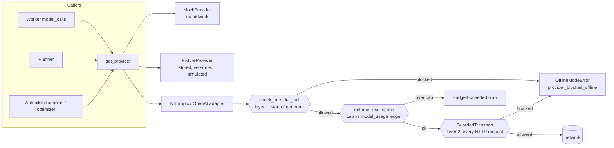
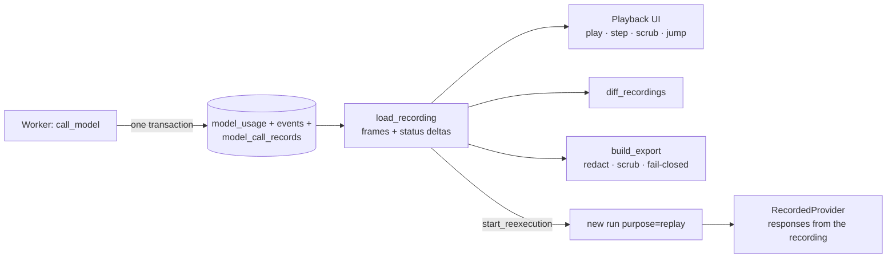

# AgentOS 2.0: architecture

This document grows phase by phase and describes only what exists in the repository. The 1.x system
(durable engine, agent runtime, Autopilot) is described in `docs/architecture.md` and
`AUTOPILOT_ARCHITECTURE.md`; this file covers 2.0 additions. Audit and plan: `docs/AGENTOS_2_AUDIT.md`.

## 1. Offline execution boundary (Phase 1)

Every model request in the system ends in a provider adapter's `generate()`. Paid providers are blocked
in code unless the execution policy allows them; no configuration document is relied upon.

* **Policy** (`ExecutionPolicy`): live requires `AGENTOS_EXECUTION_MODE=live`,
  `AGENTOS_ALLOW_PAID_PROVIDERS=true`, `AGENTOS_ENABLE_NETWORK_MODEL_REQUESTS=true` and
  `AGENTOS_MAX_REAL_API_SPEND_USD>0`. The error lists exactly which conditions fail.
* **Two independent layers.** (1) The adapter checks before building a request. (2) The real SDK clients are
  created with `GuardedTransport`, which re-checks per HTTP request, so `provider.client.messages.create()`
  called directly cannot connect either.
* **In-memory contract transports** (`httpx2.MockTransport`) are recognized and allowed offline, because they
  cannot reach the network; this keeps the SDK request/response contract tests runnable without credentials.
* **No silent fallback.** A refused or failed real-provider call fails the attempt with a typed error
  (`provider_blocked_offline` is permanent: no retry) and is recorded in `model_usage` under the *real*
  provider's name with status `failed`. The mock is never substituted.
* **Spend ledger.** `real_spend_usd()` sums recorded estimated cost for `anthropic`/`openai`;
  `enforce_real_spend()` runs inside the worker's model-call path and Autopilot's LLM wrapper, inside the
  `try` that records failed calls, so a refusal releases its budget reservation like any provider failure.
* **Fixture provider** (`providers/fixtures.py`, files in `fixtures/model_responses/*.v<N>.json`): replays
  stored responses selected by exact request digest, by substring rules, or by explicit `fixture_id`. Sets must
  declare `simulated: true`; a missing fixture raises `fixture_missing`; responses are priced with a simulated
  price (`fixture/*`) and labeled `fixture:<set>@v<N>`. `fixture_entry()` records a sanitized (redacted)
  response keyed by digest for use when real calls are enabled later.
* **Visibility.** `/api/v1/system` returns `execution` (mode, blockers, label); the header banner always shows
  `Offline: paid providers blocked` or `LIVE: paid providers enabled`, and marks keys present as blocked.
* **Migration `0003`** widens the agent provider check constraint to allow `fixture`.

What this does *not* guarantee: it controls AgentOS's model-request paths. It is not a network sandbox for
arbitrary code, and a modified build could remove the guard.

## 2. Execution engine v2 (Phase 2)

The durable engine (PostgreSQL state, `SKIP LOCKED` claims, lease tokens, fenced writes, heartbeats, retry
scheduling, immutable attempt history, idempotency keys) is unchanged. Phase 2 adds constructs on top of it,
none of which weakens those guarantees. Migration `0004`.

### 2.1 New workflow constructs

| Construct | Definition | Engine behavior |
|---|---|---|
| **Conditional branch** | any node: `when: {ref, op, value}` | Evaluated by the engine when all dependencies are terminal, against `input.*` or a declared dependency's output. False → the step is **skipped** (`step.skipped`, reason `condition_false`). An unresolvable ref or a type error is false, never an exception. 11 operators (`eq ne gt gte lt lte in not_in contains exists truthy`) |
| **Skip propagation / joins** | `trigger: all_succeeded` (default) or `any_succeeded` | A step with a skipped dependency is skipped (`upstream_skipped`) unless `any_succeeded` and at least one dependency succeeded. Skipped steps are never claimed and have no output. A step whose dependents were all skipped is reported as a run output |
| **Bounded fan-out / fan-in** | `type: fan_out`, `over` (ref to a list), `template` (an `agent_task` or `tool_task`), `max_items` ≤ 20, `on_overflow: fail\|truncate` | Never claimed by a worker. When ready, the engine creates `key[0..n-1]` child steps (each depends on the fan_out node's own dependencies, so they run in parallel) and moves the node to `waiting_child`. When every child has succeeded the node succeeds with `{"results": [...in input order], "count": n}`, so downstream nodes depend on it as a normal fan-in. More than `max_items` fails the node (default) or truncates (explicit). Expansion beyond `max_dag_nodes` fails. List items are data: they are exposed as `item`/`index` and never template-resolved |
| **Nested workflow** | `type: sub_workflow`, `workflow` (name), `input` | The engine starts the *latest version* of that workflow as a **child run** (`parent_run_id`, `parent_step_id`, `depth`) and moves the step to `waiting_child`. The child inherits the parent's priority, a deadline no later than the parent's, and a cost cap equal to the parent's remaining budget. When the child finishes, the coordinator's `subflow_tick` completes the parent step with `{"child_run_id", "output"}` (or fails it with `reason: child_failed`) and adds the child's spend to the parent. Depth limit `AGENTOS_MAX_NESTED_DEPTH` (default 3) |
| **Priority** | run `priority` 0–9 (`POST /workflows/{id}/runs {"priority": n}`) | Runs are claimed in order of *effective priority* = priority + (seconds the oldest ready step has waited ÷ `AGENTOS_PRIORITY_AGING_SECONDS`, default 30). A priority-0 step that has waited 9 intervals outranks a fresh priority-9 step, so low-priority work cannot starve |
| **Pause / resume** | `POST /runs/{id}/pause`, `/resume` (developer+) | A paused run (and its child runs) claims no new step; running steps finish; state, retries and approvals are untouched; the run deadline keeps ticking. Idempotent |
| **Cancellation** | existing | Now also cancels `waiting_child` steps and, parent→child, the child runs |

`waiting_child` is a step state without a lease: it is durable, visible in the DB and UI, and recovered by the
coordinator, not by a process. State machine additions: `PENDING → {FAILED, SUCCEEDED, WAITING_CHILD}` (engine-internal)
and `WAITING_CHILD → {SUCCEEDED, FAILED, CANCELLED}`.

**Lock order** is unchanged and deadlock-free by construction: parent run row before child run row; a child's own
transactions never lock the parent. Child→parent propagation is therefore a separate coordinator transaction
(`subflow_tick`, skip-locked, idempotent), so a crash between "child finished" and "parent updated" only delays the
parent by one tick.

### 2.2 Delivery semantics (precise)

* **Steps run at least once** while retryable: a step whose worker dies (lease expiry) is run again; the
  attempt history records `lease_expired` + the new attempt. It is **not** exactly-once for arbitrary external
  effects, and AgentOS does not claim that.
* **A completed step is never run again.** Recovery only touches `running` steps whose lease expired.
* **Stale writers are fenced.** Every completion/failure/checkpoint checks the current lease token; a worker that
  lost its lease cannot overwrite the new result (the late result is recorded as `stale` and discarded).
* **Side effects.** Every tool call carries an idempotency key (run/step scope + tool name + canonical argument
  hash), and the database allows at most one *successful* execution per key. A retried step that repeats a call
  with a recorded success gets the stored result back (marked `idempotent_replay`) instead of executing again;
  the artifact writer is additionally content-addressed and approval-gated. The remaining window is a crash
  *between* an external effect and the row that records it: a tool that cannot make its effect idempotent could
  repeat there, which is why at-least-once is the stated guarantee.
* **Engine-handled nodes** (`fan_out`, `sub_workflow`) have no worker and no lease; their transitions happen inside
  the transaction that holds the run lock, or in `subflow_tick`, so there is nothing to "execute twice".
* **Approvals** are rows; a pending approval survives any process death and is bound to its argument hash.
* The system converges: every non-terminal state has a recovery path (lease expiry, retry promotion, approval
  expiry, deadline enforcement, child propagation), so each run reaches a terminal state or is bounded by its deadline.

### 2.3 Verification

Unit tests for conditions and definition validation (`test_dag_v2.py`); integration tests for every construct on
real PostgreSQL with in-process workers (`test_engine_v2.py`); fault-injection tests with **real worker
processes** killed mid-step (`test_engine_v2_recovery.py`): a crash inside a child run, a crash after fan-out
children completed (children not re-run), SIGKILL while four fan-out children were running (each recovered once,
no duplicate children), and a pending approval surviving a killed worker. Results: `AGENTOS_2_TEST_RESULTS.md`.
Measurements: `AGENTOS_2_BENCHMARKS.md`.

## 3. Agent Flight Recorder (Phase 3)

Migration `0005`. The Flight Recorder lets a developer see exactly what an agent run did, step through it, compare it
with another run, re-execute it deterministically, and attach a sanitized trace to a bug report.

**What is captured.** For every model call, in the same transaction as its usage row and its event, an immutable
`model_call_records` row: sanitized request (system prompt, messages, tool names and descriptions, model
configuration, agent version id, prompt digest), response (text, tool calls with arguments, finish reason, usage),
latency, error, and a `request_digest` computed over the *unsanitized* request so divergence is detected exactly.
Secrets are redacted before storage; provider-raw payloads (thinking blocks, signatures) are never stored; oversize
requests keep the first and last messages and set `truncated`. A database trigger forbids UPDATE and DELETE.
Events additionally carry `trace_id` and now `span_id`, and each `model.call.*` event carries its `record_id`.

**Recorded replay** (`GET /runs/{id}/flight`) is a pure read over stored rows. A recording is a list of *frames*, one
per event in sequence order, each with the step-status changes it caused (`status_delta`), a severity
(`info|warning|error`) and trace/span ids, plus step attempts, model calls, tool executions and approvals. An
`integrity` block reports event count, first/last sequence, contiguity, gaps and a SHA-256 over the frames. The UI
applies deltas cumulatively, so scrubbing to any frame shows exactly the recorded state; tests assert that the state
after the last frame equals the final step statuses and that the state before the first frame is all `pending`.

**Deterministic re-execution** (`POST /runs/{id}/reexecute`, developer+) creates a **new** run, never touching the
recording. The run has `purpose='replay'` and `replay_of_run_id`, the same workflow version and input, and every agent
step pinned to the exact agent version the original used. In the worker:

| Aspect | Re-execution behavior |
|---|---|
| Model calls | `RecordedProvider` serves the i-th successful recorded response of the same node; no provider, no network, no cost. More calls than recorded → `replay_diverged` (permanent failure). A call whose request digest differs from the recording is still answered but flagged `request_matches_recording: false` in its event |
| Tools | only `calculator`, `document_search`, `structured_data_reader`. For agents the tool list shrinks and any other call is denied by the normal tool policy (`tool.denied`); a `tool_task` for any other tool fails with a policy violation |
| Approvals | `approval_gate` nodes complete immediately as `not_requested_in_replay`; nothing gated is ever executed or requested |
| Visibility | replay runs are tagged and filterable (`?purpose=replay`); the UI labels them and links to the original |

"Isolated test workspace" is implemented as *side-effect isolation* (purpose tag + the rules above), not as a separate
workspace, because agents and workflow definitions are workspace-scoped and copying them would change what is being
tested. This is a documented deviation from the original wording.

**Run comparison** (`GET /flight/compare?a=&b=`) aligns steps by node key and reports, per step: status, branch
(skipped in one run only), retries (failed attempts, not approval resumes), output differences as JSON paths, model
calls (request same? response same?, text snippets), and tool calls as `(tool, argument hash, status)` so a refused call
differs from an executed one; plus run-level status, output, duration, estimated cost, call counts and, for
evaluation-case runs, the pass/fail verdicts (never expected answers).

**Export** (`GET /runs/{id}/export`, developer+) builds a package of the recording and the model call bodies, removes
credential-like keys and lease tokens, redacts secret patterns, then **re-scans the result and refuses to emit it** if
anything credential-like remains (`409 export_refused`). The package carries SHA-256 hashes of the frames and itself.

**Determinism finding.** The first re-execution revealed that the task prompt for a step with several upstream
dependencies depended on database row order (`dependency_outputs` came from an unordered query), so the *same* workflow
could send a differently ordered prompt on each run. Dependencies are now assembled in declared order.
