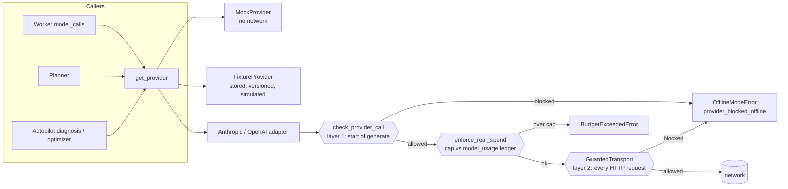

# AgentOS 2.0: architecture

This document grows phase by phase and describes only what exists in the repository. The 1.x system
(durable engine, agent runtime, Autopilot) is described in `docs/architecture.md` and
`AUTOPILOT_ARCHITECTURE.md`; this file covers 2.0 additions. Audit and plan: `docs/AGENTOS_2_AUDIT.md`.

## 1. Offline execution boundary (Phase 1)

Every model request in the system ends in a provider adapter's `generate()`. Paid providers are blocked
in code unless the execution policy allows them; no configuration document is relied upon.

* **Policy** (`ExecutionPolicy`): live requires `AGENTOS_EXECUTION_MODE=live`,
  `AGENTOS_ALLOW_PAID_PROVIDERS=true`, `AGENTOS_ENABLE_NETWORK_MODEL_REQUESTS=true` and
  `AGENTOS_MAX_REAL_API_SPEND_USD>0`. The error lists exactly which conditions fail.
* **Two independent layers.** (1) The adapter checks before building a request. (2) The real SDK clients are
  created with `GuardedTransport`, which re-checks per HTTP request, so `provider.client.messages.create()`
  called directly cannot connect either.
* **In-memory contract transports** (`httpx2.MockTransport`) are recognized and allowed offline, because they
  cannot reach the network; this keeps the SDK request/response contract tests runnable without credentials.
* **No silent fallback.** A refused or failed real-provider call fails the attempt with a typed error
  (`provider_blocked_offline` is permanent: no retry) and is recorded in `model_usage` under the *real*
  provider's name with status `failed`. The mock is never substituted.
* **Spend ledger.** `real_spend_usd()` sums recorded estimated cost for `anthropic`/`openai`;
  `enforce_real_spend()` runs inside the worker's model-call path and Autopilot's LLM wrapper, inside the
  `try` that records failed calls, so a refusal releases its budget reservation like any provider failure.
* **Fixture provider** (`providers/fixtures.py`, files in `fixtures/model_responses/*.v<N>.json`): replays
  stored responses selected by exact request digest, by substring rules, or by explicit `fixture_id`. Sets must
  declare `simulated: true`; a missing fixture raises `fixture_missing`; responses are priced with a simulated
  price (`fixture/*`) and labeled `fixture:<set>@v<N>`. `fixture_entry()` records a sanitized (redacted)
  response keyed by digest for use when real calls are enabled later.
* **Visibility.** `/api/v1/system` returns `execution` (mode, blockers, label); the header banner always shows
  `Offline: paid providers blocked` or `LIVE: paid providers enabled`, and marks keys present as blocked.
* **Migration `0003`** widens the agent provider check constraint to allow `fixture`.

What this does *not* guarantee: it controls AgentOS's model-request paths. It is not a network sandbox for
arbitrary code, and a modified build could remove the guard.
