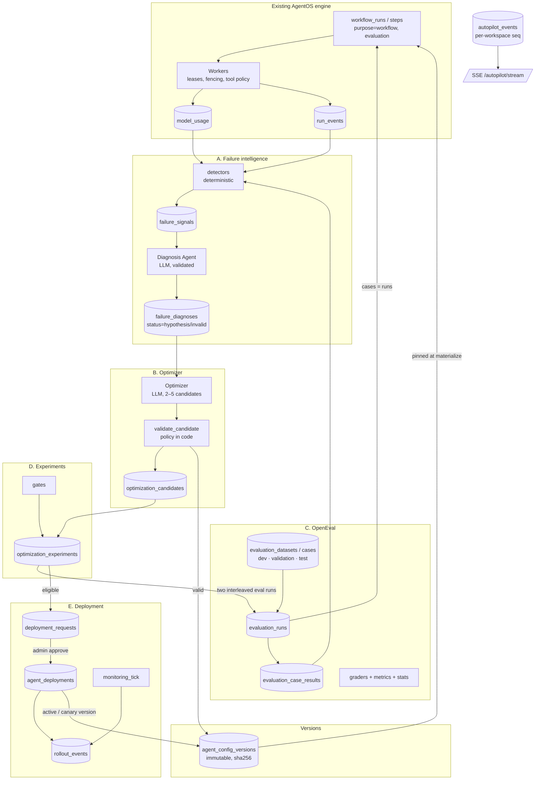

# AgentOS Autopilot: architecture

Autopilot adds an evaluation-driven improvement loop on top of AgentOS. It proposes changes
to an agent's configuration, measures them against a versioned benchmark with paired
statistics, rejects regressions, and deploys only what a human administrator approves. It
does not modify code, permissions, evaluation data or observability. It changes **agent
configuration versions** only.

```
Run → Observe → Diagnose → Propose → Evaluate → Compare → Approve → Deploy → Monitor
 ↑                                                                            │
 └──────────────────────────── Rollback (admin) ◄─────────────────────────────┘
```

## 1. Phase 0 audit (state before the upgrade)

What existed and was reused unchanged:

* **Durable engine.** SKIP LOCKED claims, leases, fencing, retries, budgets, approvals, SSE
  and OTel. Evaluation cases run through it as ordinary workflow runs, so they get crash
  recovery, budgets and tool policy for free.
* **Agent runtime.** A bounded loop with checkpoints, JSON output contracts, and the effective
  tool set = agent allow-list ∩ node policy ∩ registry. Autopilot never bypasses it.
* **Providers.** Anthropic, OpenAI, and the deterministic mock. A real-provider failure raises
  `ProviderError` and is never replaced by mock output.
* **Usage accounting.** `model_usage` with a versioned price table, labeled
  actual / partial / simulated / unknown.

Gaps that blocked a safe improvement loop:

| Gap | Consequence | Fix |
|---|---|---|
| `agent_definitions` rows were mutable, with no history | Runs could not say which config they used; no rollback | Immutable, content-addressed `agent_config_versions`; every step pins `agent_version_id` |
| No evaluation datasets, graders or metrics | "Better" could not be measured | `packages/openeval` plus versioned datasets with dev/validation/test splits |
| `model_usage.run_id` was NOT NULL | Diagnosis and optimizer calls could not be accounted | Nullable `run_id`, plus `workspace_id`, `purpose` and `autopilot_ref` (cycle) |
| Error types only (no failure taxonomy) | Failures could not be clustered or diagnosed | `taxonomy.py` + deterministic detectors → `failure_signals` |
| No deployment concept | Agent edits took effect instantly, unaudited | Deployment requests, admin approval, deployments and rollout events, all append-only |
| Users defaulted to "the only workspace" | Second memberships broke header-less API calls | Default = earliest-created membership; `X-Workspace-Id` overrides |

Coverage before the upgrade: 125 backend tests, 5 Playwright tests and 3 API demos. All of
them still pass (see AUTOPILOT_TEST_RESULTS.md).

## 2. Components



All Autopilot state is in PostgreSQL. The worker's coordinator loop drives the long-running
parts (`evaluation_tick`, `experiments_tick`, `monitoring_tick`). They are idempotent and safe
to run on several workers at once. Redis only carries wake-ups and live events.

## 3. Versioning and pinning

* `AgentConfig` (Pydantic, frozen, `extra=forbid`) is the full behavior-relevant config:
  instructions, provider/model, model_configuration, tools and tool descriptions,
  tool_strategy, step, cost, time and retry limits. Its hash is the sha256 of the canonical
  JSON. `(agent_id, config_hash)` is unique, so re-proposing an identical config reuses the
  version.
* **Pinning:** `materialize_run` resolves each agent step's version as explicit override
  (evaluations) > canary bucket (`sha256(run_id) mod 100 < canary_percent`) > active version.
  The step row stores `agent_version_id`, and the worker loads that exact snapshot. A
  deployment or rollback therefore affects only new runs. Steps from before the upgrade
  (`agent_version_id IS NULL`) fall back to the agent row, so old histories still render and
  retry.
* `PATCH /agents/{id}` keeps its contract. A behavior change creates a new version, activates
  it, and records a `manual_edit` deployment, so manual edits are audited too.
* **DB-level immutability (triggers):**
  * Versions, datasets, cases, rollout events and autopilot events reject UPDATE and DELETE.
  * Completed experiments, completed evaluation runs and graded case results are sealed.
  * Deployments may only change `status` (active → superseded / rolled_back).

## 4. Evaluation integrity (OpenEval)

* **Cases run as real workflow runs** (`purpose='evaluation'`, hidden harness workflow). Only
  `input` reaches the agent. `expected_output` is read by the grader, and the node's output
  contract is a schema *derived* from the expected shape, so it carries no values.
* **Graders are deterministic:**
  * `schema_validation`, `exact_match`, `numeric_tolerance` (an expected null must be null)
  * `tool_correctness` (required and forbidden tools, max calls)
  * `source_citation_check` (the cited source must have been retrieved in this run *and*
    contain the value)
  * `task_completion`

  `llm_judge` exists, but it is advisory only, needs at least 2 calibration examples, and
  never feeds a gate.
* **Splits:**
  * The optimizer sees development examples and aggregate validation metrics only.
  * The test split is never used for selection, and experiments reject the development split.
  * Hidden-split failure details are redacted from failure signals and diagnosis evidence.
  * Candidates that contain any hidden expected value (normalized number or string
    fingerprint) are rejected as leakage.
* **Metrics carry numerators and denominators.** `cost_per_successful_task` is `null` (not 0,
  not ∞) when nothing succeeded. Executions skipped by the budget cap are `not_run`, counted
  as incomplete, and excluded from the success denominators.
* **Conditions** are recorded per evaluation run: version hash, dataset hash, trials, seeds,
  concurrency, provider and model, and caps.

## 5. Experiments and statistics

* Baseline and candidate run the **same cases in an interleaved order** (sort keys alternate
  arms), so drift in the environment affects both arms.
* Per-case success = the mean over trials. The **paired percentile bootstrap** resamples cases
  (10,000 resamples, fixed seed). An exact McNemar test is reported alongside.
* A difference is called *statistically supported* only when n ≥ `min_validation_cases` and
  the 95% CI excludes 0. Otherwise the summary says it is inconclusive. A regression is a case
  with baseline success ≥ 0.5 and candidate success < 0.5.
* **Gates** (`gates.py`). A failed hard gate makes the candidate `not_eligible`; a failed soft
  gate makes it `inconclusive`.

  | Gate | Type |
  |---|---|
  | sample_size | soft |
  | evaluation_complete | soft |
  | no_unauthorized_tool_behavior | hard |
  | per_case_regressions (≤ max_regressions, default 0) | hard |
  | critical_case_regressions | hard |
  | no_supported_quality_degradation | hard |
  | non_inferiority (margin) | hard |
  | minimum_success_rate | hard |
  | cost_per_successful_task (≤ +10% and ≤ cap; undefined when the candidate has no successes) | hard |

  `improvement_demonstrated` additionally requires the CI lower bound > 0. A candidate can be
  eligible without demonstrating improvement (as in Demo 3), and the UI says so.

## 6. Optimizer restrictions (enforced in `validate_candidate`, not in prompts)

* Changes are limited to `OPTIMIZABLE_FIELDS` ∩ the workspace policy. `max_cost_usd`,
  `timeout_seconds` and `schema_version` can never be changed. The scenario wiring cannot be
  changed.
* `allowed_tool_ids` may only **shrink**; adding a tool is rejected even if the tool exists.
* `provider` and `model` must be in `policy.allowed_models`. Sampling parameters are rejected
  for providers whose current models do not accept them.
* `max_steps` is limited by `max_steps_limit` and `retry_max_attempts` by a fixed cap.
* The candidate must differ from its parent. Each candidate needs a rationale per change.
* Rejected:
  * instructions matching a safety-weakening pattern (ignore/disable policy, approvals,
    permissions, logging, tracing)
  * candidates containing hidden answers
* Rejected candidates are stored (`rejected_policy`, with violations), with no version
  created, and are visible in the UI.
* The LLM only produces a *proposal*. The stored version is built by code from the parent
  config plus the validated changes.

## 7. Deployment

* `POST /deployments/promote` requires an `eligible` experiment whose baseline is still the
  active version (otherwise the request is stale). There is one pending request per agent.
* Approve and reject are admin-only. Expiry (default 48 h) and staleness are checked at
  decision time and persisted.
* Approval:
  1. supersedes the current deployment,
  2. creates a `promotion` or `canary` deployment,
  3. updates `active_version_id` (or `canary_version_id` and percent),
  4. emits rollout and Autopilot events.
* Rollback is admin-only, needs a reason, and can only target a version that was previously
  deployed for that agent. It is a new record; history is never rewritten.
* `monitoring_tick` compares the live failure rate of runs pinned to the deployed version with
  runs pinned to its predecessor. If at least `min_live_samples` runs exist and the increase is
  ≥ the threshold, it writes a `regression_detected` rollout event. `auto_rollback` is off by
  default.

## 8. Diagnosis

* The evidence pack is built from failure signals: step errors, sanitized event snippets, tool
  executions and aggregate evaluation failures. Hidden-split details are excluded, secrets are
  redacted, and every item has an id such as `signal:…`, `event:…`, `step:…` or
  `tool_execution:…`.
* The model output is validated against a Pydantic schema. Any cited id not present in the
  pack, or an unknown category, makes the diagnosis `invalid` (stored, shown, never used for
  candidate generation).
* Every diagnosis is stored with `status='hypothesis'` and the standard limitation: *"This is
  a model-generated hypothesis from the evidence shown, not a verified root cause."*

## 9. Cost controls

* The default Autopilot providers are `mock`. With Anthropic, Autopilot uses
  `claude-haiku-5-5` at `effort=low` (`AGENTOS_AUTOPILOT_ANTHROPIC_MODEL`). OpenAI requires an
  explicit `AGENTOS_AUTOPILOT_OPENAI_MODEL`.
* Each diagnosis/optimizer call reserves $0.05 against `max_cycle_spend_usd` (default $2) for
  its cycle, using recorded spend.
* Further limits:
  * `max_candidates` (3, at most 5) and `max_eval_trials` (3)
  * `max_eval_concurrency` (4)
  * `per_case_max_cost_usd` (0.25)
* Starting an evaluation or experiment whose worst-case cost exceeds
  `paid_confirmation_threshold_usd` returns 409 `cost_confirmation_required` unless
  `confirm_cost=true`. Mock runs are
  priced as simulated and never need confirmation.

## 10. Live progress

`autopilot_events` (append-only, per-workspace `seq` from `workspaces.autopilot_seq`) records
these events:

* `failure.detected`, `diagnosis.started` / `.completed`
* `candidate.generated` / `.rejected`
* `evaluation.started` / `.progress` / `.completed`
* `experiment.started` / `.completed`
* `deployment.requested` / `.approved` / `.rejected`
* `version.deployed` / `.rolled_back`, `regression.detected`

`GET /autopilot/stream` replays from `Last-Event-ID` and then follows the Redis channel; the
dashboard falls back to polling when SSE drops.
