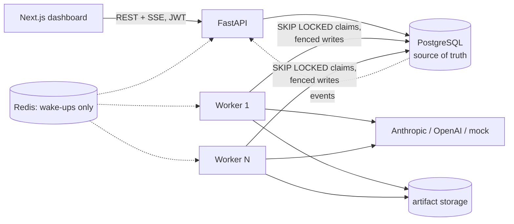

# AgentOS

**Durable execution for AI agent workflows.** Multi-step agent DAGs run across
multiple workers and survive worker crashes. Tool permissions are enforced in code,
sensitive actions pause for human approval, and every attempt, model call, tool
call and dollar is inspectable.

> A production-inspired portfolio project, not a production system. See
> [Known limitations](#known-limitations) for what is hardened and what is not.


## The problem

Most agent frameworks run an LLM tool loop inside one process. When that process
dies mid-run, work is lost or silently repeated. When a model asks for a dangerous
tool, the only guard is the prompt. When something goes wrong, there's no record of
which attempt did what. AgentOS treats agent workflows like any other distributed
job system. State lives in PostgreSQL, work is leased and fenced, side effects are
idempotent or approval-gated, and the model is never trusted to authorize anything.

## What makes it different

* **Crash-safe scheduling.** Steps are claimed with `SELECT … FOR UPDATE SKIP LOCKED`
  under per-claim lease tokens. Workers heartbeat. When a worker dies, its lease
  expires and another worker resumes the step from a durable conversation checkpoint.
* **Fencing.** Every completion, failure, checkpoint and side-effecting write checks
  the current lease token, so a late worker can never overwrite a newer result. This
  is tested with real processes being killed.
* **Policy in code, not prompts.** Effective tools are the agent's allow-list ∩ the
  node policy ∩ the registry. AI-generated plans go through the same validator as
  hand-written DAGs. A document that tells the model to exfiltrate secrets gets the
  call *denied*; a test proves it.
* **Human approval bound to exact arguments.** Approvals are tied to a tool execution
  and the SHA-256 of its canonical arguments, are single-use, and expire. A rejected
  action never executes.
* **Honest accounting.** Token usage comes from provider responses (unknown stays
  `NULL`, never 0). Costs come from a versioned price table and are labeled
  `actual / partial / simulated / unknown`. Budgets are reserved atomically before
  each call.
* **Measured, not claimed.** Benchmarks run real worker processes and compute every
  number from persisted timestamps, including one optimization with an A/B.

## Autopilot: evaluation-driven agent improvement

Autopilot proposes changes to an agent's configuration, measures them rigorously, rejects
regressions, and deploys improvements only with human approval:

**Run → Observe → Diagnose → Propose → Evaluate → Compare → Approve → Deploy → Monitor → (Rollback)**

* **Immutable agent versions.** Every config is a content-addressed version, and every step
  records the version it ran. Deployments and rollbacks affect new runs only.
* **Failure intelligence.** Deterministic detectors classify failures (infrastructure vs
  agent). An LLM Diagnosis Agent proposes a *hypothesis* that must cite evidence ids from a
  sanitized evidence pack, or it is stored as `invalid`.
* **Constrained optimizer.** It generates 2–5 candidates. Restrictions are enforced in code:
  * only approved fields can change, and tools can only be removed;
  * the model must be on an allow-list, and budgets and timeouts are immutable;
  * changes that weaken safety or leak hidden answers are rejected.
* **OpenEval** (`packages/openeval`, standalone). Versioned dev/validation/test datasets,
  deterministic graders (schema, exact, numeric tolerance, tool correctness, citations that
  must match retrieved sources), metrics with denominators, and an advisory-only LLM judge.
* **Paired experiments.** Baseline and candidate run the same cases, interleaved, with
  repeated trials, a bootstrap 95% CI and McNemar. Nothing is called significant unless the
  CI excludes 0 with enough cases.
* **Gates, then an admin.** Per-case regressions, non-inferiority, unauthorized tool
  behavior and cost per *successful* task are checked before an administrator approves.
  Live monitoring flags regressions, and rollback is one audited action.

| | |
|---|---|
|  |  |
|  |  |

```bash
make up && make autopilot-demo   # repair a flawed agent · reject a fake improvement · roll back a live regression
make autopilot-bench             # full cycle on an isolated database -> docs/autopilot-benchmarks.md
```

On the mock provider, the demo agent's validation success went from 43.8% to 100%
(paired difference +0.56, 95% CI [+0.31, +0.81], n=16). The held-out test went from 37.5%
to 100%. A 5.6× cheaper "fast path" candidate was refused (0% success, 7 per-case
regressions), and a step cap that passed offline gates but failed 10/10 live runs was rolled
back. These are measurements of a **scripted mock agent**, not of a real model. Docs:
[architecture](AUTOPILOT_ARCHITECTURE.md) · [status](AUTOPILOT_IMPLEMENTATION_STATUS.md) ·
[test results](AUTOPILOT_TEST_RESULTS.md) · [limitations](AUTOPILOT_KNOWN_LIMITATIONS.md) ·
[benchmark](docs/autopilot-benchmarks.md).

## Screenshots

| | |
|---|---|
|  |  |
|  |  |
|  |  |

## Architecture



Details, sequence diagrams and lock ordering: [docs/architecture.md](docs/architecture.md).

## Features

* **Workflows:** versioned, immutable DAGs with `agent_task`, `tool_task`,
  `approval_gate` and `aggregation` nodes. Validation checks cycles (Kahn's
  algorithm), missing or duplicate keys, unauthorized tools, references and limits.
  AI planning works in two forms: synchronous (`/workflows/plan`) and as a durable
  planner step (`/runs/planned`), with bounded replanning on invalid plans.
* **Engine:** leases, heartbeats, fencing, exponential backoff with jitter, retry
  deadlines, transient vs permanent classification, cooperative cancellation, run
  deadlines, budget reservation and reconciliation, per-run concurrency limits.
* **Agents:** a bounded loop (steps, cost, time) with checkpointing after every turn,
  JSON output contracts with one repair turn, and refusal handling.
* **Providers:** Anthropic (official SDK, Messages API, adaptive-thinking models,
  server-side refusal fallback on supported models), OpenAI (official SDK,
  Responses API, `store=false`), and a deterministic mock with scenarios for
  research, analysis, writing, planning, invalid plans, rate limits, timeouts and
  forbidden tools.
* **Tools:** calculator (hand-written parser, no `eval`), PostgreSQL full-text
  document search with citations, CSV/JSON reader (workspace-confined, size-capped,
  optional JSON Schema), and an approval-gated artifact writer (atomic,
  content-addressed, idempotent, fenced). No shell, no HTTP fetch.
* **Observability:** a persisted per-run event log, SSE with `Last-Event-ID` replay,
  OpenTelemetry spans (privacy-aware), structured redacted logs, and metrics
  endpoints for usage, cost, latency, failures, tools and workers.
* **Autopilot:** see [above](#autopilot-evaluation-driven-agent-improvement). Pages:
  Overview, Failures, Improvements, Evaluations, Experiments, Deployments.
* **Dashboard:** overview, agents, workflows (planner + JSON editor + live
  validation + DAG preview), the run detail page (live DAG, step panel with
  attempts, model calls, tool calls, approvals and events, a timeline of attempts,
  artifacts), approvals, artifacts, observability and settings.

## Tech stack

Python 3.13, FastAPI, Pydantic v2, SQLAlchemy 2 (async, asyncpg), Alembic,
PostgreSQL 16, Redis 7, structlog, OpenTelemetry, `anthropic` 2.3, `openai` 3.37,
pytest, ruff, mypy `--strict` · Next.js 16 (App Router, Cache Components),
TypeScript strict, Tailwind 4, Radix primitives, React Flow 12, TanStack Query 5,
Recharts 3, openapi-typescript + openapi-fetch, Playwright · Docker Compose, uv, npm.

## Quick start

Requires Docker. No API keys are needed: everything runs on the mock provider.

```bash
cp .env.example .env            # optional; defaults work for local use
make up                         # postgres, redis, migrate+seed, api, 2 workers, web
open http://localhost:3000      # admin@agentos.dev / agentos-admin
make demo                       # runs and verifies all three demos via the API
make autopilot-demo             # the three Autopilot demos
```

Autopilot's own model calls (diagnosis, optimizer) default to the mock as well. To use a
real model, set `diagnosis_provider`/`optimizer_provider` in the workspace policy
(`PUT /api/v1/autopilot/policy`). Anthropic uses `AGENTOS_AUTOPILOT_ANTHROPIC_MODEL`
(default `claude-haiku-5-5`, low effort). OpenAI needs `AGENTOS_AUTOPILOT_OPENAI_MODEL`.
Spend is capped per optimization cycle.

To use a real model, add `ANTHROPIC_API_KEY` (and optionally
`AGENTOS_PLANNER_PROVIDER=anthropic`, then re-seed with
`AGENTOS_DEMO_PROVIDER=anthropic`). OpenAI needs `OPENAI_API_KEY` **and**
`AGENTOS_OPENAI_MODEL`; no default model ID is shipped. A failing real provider is
reported as an error, never silently replaced by the mock.

Local development without containers for the app processes:

```bash
make install
docker compose up -d postgres redis
make dev                        # api :8000, 2 supervised workers, web :3000
```

## Example workflows

| Demo | Shows | Run |
|---|---|---|
| [Research report](examples/research-report/README.md) | 3 parallel research agents -> analysis with the calculator -> writer -> approval -> Markdown artifact with citations, conflicts and missing evidence | `make demo-research` |
| [Failure recovery](examples/failure-recovery/README.md) | A worker process is killed mid-step; lease expiry; another worker retries; completed steps are not re-run | `make demo-recovery` |
| [Permission enforcement](examples/approval-workflow/README.md) | Reject (no side effect) -> resubmission -> approve -> crash right after the write -> exactly one artifact; unauthorized tool denied | `make demo-permissions` |

Presenter notes: [docs/demo-script.md](docs/demo-script.md).

## API

REST under `/api/v1` with OpenAPI at `http://localhost:8000/docs`. It provides
idempotency keys for run creation and approvals, pagination, and an SSE stream per
run. See [docs/api.md](docs/api.md).

## Failure-recovery design

At-least-once execution of retryable steps, with idempotency for side effects. It
does **not** claim exactly-once. Leases plus fencing tokens prevent concurrent
owners and stale writes. Checkpoints prevent re-running finished model turns.
Idempotency keys plus unique constraints prevent duplicate artifacts. Full
semantics, guarantees and gaps: [docs/failure-semantics.md](docs/failure-semantics.md).

## Security model

Workspace-scoped authorization on every endpoint and three roles. Tool policy,
approval binding, path confinement, request size limits, rate limits, redaction,
and production startup checks are all enforced in code. Prompt-injection resistance
comes from the policy layer, not the prompt. See [docs/security.md](docs/security.md).

## Benchmarks

Apple M1, 8 GB RAM, PostgreSQL 16 in Docker Desktop; real worker processes; numbers
computed from persisted timestamps. Full methodology and tables:
[docs/benchmarks.md](docs/benchmarks.md).

| Measurement | Result |
|---|---|
| Throughput, no-op 20-node fan-out, 40 workflows | 118–222 steps/s (1–4 workers) |
| Dependency-aware parallelism, 8 × 0.5 s nodes | 1.27 s vs 4.65 s sequential: **3.68× speedup** (ideal 8×) |
| Crash recovery, lease TTL 2 / 5 / 10 s | median detection 2.00 / 5.05 / 9.51 s; **18/18 recovered**; 0 duplicate attempts; 0 completed-step re-executions |
| Orchestration overhead per single-call agent step | ~76–87 ms p50 |
| Autopilot cycle (mock agent, 16 validation cases × 3 trials) | fix 43.8% → 100% (CI95 [+0.31, +0.81]); fake "cheaper" candidate refused; live regression 0% → 100% failures, 0% after rollback; [report](docs/autopilot-benchmarks.md) |
| Optimization: batched event writes under the run lock | **+11.6% to +22.1%** median steps/s (A/B, 4 interleaved reps, ranges non-overlapping) |


## Testing

```bash
docker compose up -d postgres redis
make test        # 193 backend tests on real PostgreSQL: 190 pass, 3 opt-in live provider tests skip
make lint typecheck web-check
make up && make e2e   # Playwright against the running stack
```

Unit tests cover the DAG, state machines, retry, pricing, tools, redaction,
provider normalization through the real SDKs with a mocked transport, and the
planner. Integration tests cover concurrent claims, fencing, lease expiry,
cancellation, budgets, approvals, event ordering, idempotency, authorization, SSE
replay, Redis outage, and **real worker processes killed mid-step**. Results:
[TEST_RESULTS.md](TEST_RESULTS.md) and [AUTOPILOT_TEST_RESULTS.md](AUTOPILOT_TEST_RESULTS.md)
(Autopilot: OpenEval graders and statistics, optimizer restrictions, versioning triggers,
the full cycle on real workers, and 2 more Playwright specs, 7/7 in total).

## Engineering tradeoffs

* **PostgreSQL as the queue.** It gives transactional state and leases with no extra
  broker. The cost is a per-run serialization point (the run row lock), which the
  benchmarks measure. A Kafka/NATS design would scale further but would add a second
  source of truth.
* **Per-run lock ordering** over finer-grained locks: simple and deadlock-free by
  construction, at the price of serializing transitions within one run.
* **Polling plus Redis wake-ups**, not `LISTEN/NOTIFY`: works through connection
  poolers and degrades gracefully. Redis is an optimization, never a dependency.
* **SSE over WebSockets**: one-way, proxy-friendly, and resumable with
  `Last-Event-ID`.
* **Hand-written mock policies** instead of recorded responses: deterministic, yet
  they consume real tool output, so the pipeline (search, calculator, citations) is
  genuinely exercised.

## Known limitations

See [KNOWN_LIMITATIONS.md](KNOWN_LIMITATIONS.md). Highlights:

* The real-provider adapters are tested against the official SDKs with a mocked HTTP
  transport, **but were not run against the live APIs here** because no credentials
  were available. Opt-in smoke tests exist (`AGENTOS_LIVE_TESTS=1`).
* Development authentication only (seeded users, HS256, `localStorage` tokens).
* Single PostgreSQL instance. No horizontal API autoscaling story, no multi-region
  setup.
* No HTTP fetch tool. Document search is keyword-based (no embeddings).
* The CI workflow is included but has not been run on GitHub from this environment.
* Autopilot's diagnosis and optimizer were never run against a real model, and its
  benchmark agent is scripted. See [AUTOPILOT_KNOWN_LIMITATIONS.md](AUTOPILOT_KNOWN_LIMITATIONS.md).

## Roadmap

OIDC authentication and per-user rate limits · an SSRF-safe HTTP fetch tool ·
embedding search (pgvector) · a drag-and-drop DAG editor · per-tool approval
policies (auto-approve rules, deny lists) · `LISTEN/NOTIFY` wake-ups · partitioned
event tables and retention · a Kubernetes manifest with worker autoscaling on queue
depth.

## License

MIT, see [LICENSE](LICENSE).
