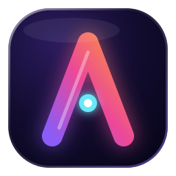
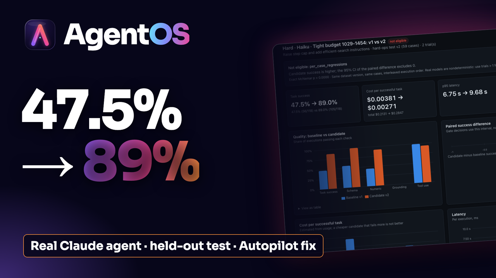
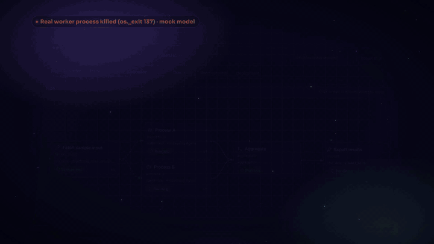
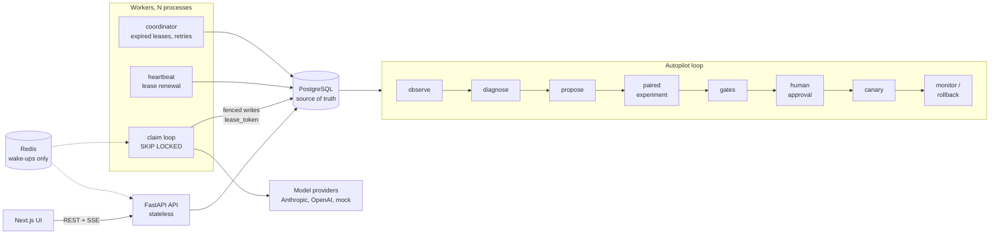

<p align="center">
  
</p>

<h1 align="center">AgentOS</h1>

<p align="center"><b>Don't trust your AI agents. Prove them.</b></p>

<p align="center">
  AgentOS runs multi-agent LLM workflows that survive worker crashes, enforce tool permissions in code, and change only when a
  paired experiment proves the change helped. It is built for engineers who need to know why an agent failed and whether a fix worked.
</p>

<p align="center">
  <a href="https://github.com/DMgaming00/AgentOS/actions/workflows/ci.yml"></a>
  
  <a href="LICENSE"></a>
</p>

<p align="center">
  <!-- TODO(Dev): replace YOUTUBE_URL with the video link -->
  <a href="YOUTUBE_URL"></a>
  <br><sub>Watch the demo video. Below: a worker is killed mid-step and another worker finishes the run.</sub>
</p>

<p align="center">
  
</p>

## Results at a glance

| Result | Caveat | Source |
|---|---|---|
| **47.5% → 89.0%** on a held-out test split after Autopilot repaired a real Claude Haiku agent (paired diff +0.415, 95% CI [+0.29, +0.54], 59 cases × 2 trials) | Real model, one run. The agent was deliberately constrained (3-step budget); the gate still blocked promotion for 2 per-case regressions | [hard_results.json](benchmarks/results/real_haiku/hard_results.json) |
| **18/18** worker processes killed mid-step were recovered, **0** duplicate attempts, **0** completed steps re-run | Mock provider, local machine, 6 crashes at each of 3 lease TTLs | [docs/benchmarks.md](docs/benchmarks.md) (Benchmark 3) |
| **3.68×** speedup for 8 parallel 0.5 s steps vs sequential (ideal 8×) | Mock steps; the gap is per-step scheduling overhead | [docs/benchmarks.md](docs/benchmarks.md) (Benchmark 2) |
| **28/28** prompt-injection attacks contained, 0/8 benign controls blocked, in 5/5 runs | A deliberately gullible mock model that obeys every injection; this tests the enforcement layer, not a real model | [AGENTOS_2_BENCHMARKS.md](AGENTOS_2_BENCHMARKS.md#security-center-enforcement-under-a-labeled-attack-corpus) |

435 backend tests and 27 Playwright end-to-end specs pass ([AGENTOS_2_TEST_RESULTS.md](AGENTOS_2_TEST_RESULTS.md)). All real-model
work cost about **$14** in total ($0.76 + about $13.2, price-table estimates, same file). Paid calls are blocked by default.
More real-model results, including the weak ones: [docs/real-model-results.md](docs/real-model-results.md).

## Why this exists

| Problem with most agent setups | What AgentOS does |
|---|---|
| The agent loop runs in one process. When it crashes, the work is lost or repeated. | State lives in PostgreSQL. Steps are leased, fenced and checkpointed, so another worker resumes from the last model turn. |
| Safety lives in the prompt. Nothing in code stops a dangerous tool call. | Each step gets only the tools its agent and node allow. Risky calls wait for a human approval bound to the exact arguments. |
| Nobody can prove a prompt or config change helped. | Changes ship only after a paired experiment on held-out cases passes statistical gates, an admin approves, and a canary stays healthy. |

## Architecture



PostgreSQL holds every run, step, attempt, lease, approval, event and dollar. Redis only says "something changed"; every reader
re-reads PostgreSQL, so losing Redis costs latency, not correctness (`test_works_without_redis`). Workers are identical: each one
claims work, heartbeats, and runs the coordinator duties. Autopilot reads the same records that the engine writes. More diagrams
(run lifecycle, approval flow, crash recovery): [docs/architecture.md](docs/architecture.md).

## Deep dive 1: durable execution

A step is claimed in one transaction: lock the run row with `FOR UPDATE SKIP LOCKED` (a busy run is skipped, not waited on), move
ready steps to `running`, issue a fresh `lease_token`, and insert an attempt row. The worker then renews the lease with heartbeats.
Every write it makes afterwards (completion, failure, checkpoint, side-effecting tool call) checks
`lease_token = :mine AND status = 'running'` inside the run-locked transaction. That check is the fencing token.

What happens when a worker dies mid-step:

1. Worker 1 holds step S with lease token T1. Its process is killed. No cleanup runs.
2. Heartbeats stop, so the lease reaches `lease_expires_at`.
3. Any worker's coordinator finds `running AND lease_expires_at < now()`, marks the attempt `lease_expired`, and moves S to
   `retry_wait` with backoff.
4. S becomes `ready`. Worker 2 claims it with a new token T2.
5. Worker 2 loads the conversation checkpoint written after Worker 1's last model turn, so finished model calls are not repeated.
6. Worker 2 completes S with T2. Dependent steps are promoted.
7. If Worker 1 was only paused, not dead, and wakes up, its write with T1 is rejected (`StaleLeaseError`, event
   `step.stale_result_rejected`).

Side effects get two more guards. A side-effecting tool call has a deterministic idempotency key,
`sha256(run_id, node_key, tool, canonical_args)`, so a retry replays the recorded result instead of acting twice. The artifact
writer is also guarded by `UNIQUE (run_id, idempotency_key)`. Approvals are single-use and tied to the SHA-256 of the exact
arguments.

Measured: with lease TTLs of 2, 5 and 10 s, the median time to detect a dead worker was 2.00, 5.05 and 9.51 s, and all 18 crashes
were recovered with no duplicate attempts ([docs/benchmarks.md](docs/benchmarks.md)). Guarantees, tests that prove each one, and known
gaps: [docs/failure-semantics.md](docs/failure-semantics.md).

## Deep dive 2: Autopilot and gated evaluation

```
observe → diagnose → propose → paired experiment → gates → human approval → canary → monitor / rollback
```

* **Observe and diagnose.** Deterministic detectors label failures from traces (for example `TASK_INCOMPLETE`,
  `REPETITIVE_TOOL_LOOP`) and separate infrastructure faults from agent faults. A diagnosis model writes a hypothesis that must cite
  evidence ids from a sanitized evidence pack, or it is stored as invalid.
* **Propose.** A rule engine and an optimizer model suggest candidate configs. Limits are enforced in code: only approved fields
  change, tools can only be removed, budgets and timeouts are immutable, and safety-weakening instructions are rejected.
* **Paired experiment.** Baseline and candidate run the same cases in interleaved order, with repeated trials. The comparison is a
  paired percentile bootstrap over cases (10,000 resamples) with an exact McNemar test alongside.
* **Gates.** Hard gates include per-case regressions (default: none allowed), no unauthorized tool behavior, non-inferiority,
  and cost per successful task. "Improvement demonstrated" also needs the CI lower bound above 0.
* **Ship.** An admin approves. A seeded canary routes part of the traffic. Rollback rules need statistical evidence (one-sided Fisher
  and binomial tests) before they act.

**The real-model repair.** A Claude Haiku agent with a 3-step budget solved 48% of validation tasks. Claude Sonnet's diagnosis said:
*"The agent's max_steps=3 budget is too small for these multi-hop document questions."* The model-written fix scored
**48.0% → 98.0%** on validation (50 cases × 3 trials, CI [+0.38, +0.62]) and **47.5% → 89.0%** on the held-out test. The gate
still said *not eligible* because 2 test cases regressed, so nothing was promoted. Source:
[hard_results.json](benchmarks/results/real_haiku/hard_results.json).

**The change that looked better and was refused.** A prompt edit raised Haiku's success from **70.8% to 77.1%** (16 cases × 3
trials). The paired 95% CI was [-0.125, +0.271], McNemar p = 0.625, and one case regressed. The gate marked it
**not eligible**: the evidence did not support the improvement. Source: [paired.json](benchmarks/results/real_haiku/paired.json).

**The rollback.** In 5 out of 5 repeated runs, a candidate that passed offline gates but failed live traffic was rolled back
automatically, with 0/160 runs pinned to the wrong version (mock provider;
[AGENTOS_2_BENCHMARKS.md](AGENTOS_2_BENCHMARKS.md#release-center-routing-rollback-rules-and-version-consistency)). Building that
benchmark exposed a bug: the first rollback rule rolled back a *healthy* canary 28-37% of the time. Adding the significance tests
fixed it.

Design and gate table: [AUTOPILOT_ARCHITECTURE.md](AUTOPILOT_ARCHITECTURE.md).

## Also includes

| Lab | What it proves | Details |
|---|---|---|
| Chaos Lab | Seeded faults at real boundaries (provider, tool, database, worker) leave state consistent and runs recoverable | [benchmarks](AGENTOS_2_BENCHMARKS.md#chaos-lab-resilience-scorecards) |
| Security Center | Tool policy is enforced in code against a labeled injection corpus, with no secrets in traces | [security model](docs/security.md) |
| Agent Arena | Agents are ranked on a held-out split with confidence intervals, and statistical ties are shown as ties | [real-model results](docs/real-model-results.md) |
| Memory Lab | Memory strategies compared under fact churn; stale summaries fail where retrieval does not | [benchmarks](AGENTOS_2_BENCHMARKS.md#memory-lab-strategies-under-fact-churn) |
| FinOps | Budgets are reserved atomically before each model call; every cost is labeled actual, simulated or unknown | [features](docs/features.md) |
| Release Center | Canary routing, rollback rules and version pinning behave as specified | [benchmarks](AGENTOS_2_BENCHMARKS.md#release-center-routing-rollback-rules-and-version-consistency) |
| Flight Recorder | Any run can be replayed frame by frame from immutable records | [features](docs/features.md) |

Screenshots of every page: [docs/visual-tour.md](docs/visual-tour.md).

## Quickstart

Requires Docker. No API keys are needed.

```bash
git clone https://github.com/DMgaming00/AgentOS.git && cd AgentOS
make up          # postgres, redis, migrations + seed, api, 2 workers, web
make showcase    # five end-to-end demos with PASS/FAIL checks, mock provider only
```

Open http://localhost:3000 and sign in as `admin@agentos.dev` / `agentos-admin`. The demos are described in
[docs/demos/README.md](docs/demos/README.md).

**Real models, safely.** Paid calls are refused unless all four of these are set in `.env`, and a key alone is never enough:

```bash
AGENTOS_EXECUTION_MODE=live
AGENTOS_ALLOW_PAID_PROVIDERS=true
AGENTOS_ENABLE_NETWORK_MODEL_REQUESTS=true
AGENTOS_MAX_REAL_API_SPEND_USD=5     # hard cap, checked against recorded spend before every request
```

The check runs inside the provider adapter and again under the SDK's HTTP transport. The test suite always runs offline, whatever
`.env` says. Step-by-step guide: [docs/ENABLE_REAL_CLAUDE.md](docs/ENABLE_REAL_CLAUDE.md).

## Design decisions and tradeoffs

**At-least-once, not exactly-once.** A worker can crash after doing work but before recording it, so a step can run twice. No
scheduler can make external effects exactly-once by itself. AgentOS makes retries safe instead: checkpoints after every model turn,
idempotency keys on side effects, and human approval for anything ambiguous. The cost: a model call that was in flight during a
crash is billed twice.

**PostgreSQL `SKIP LOCKED` instead of a Redis or Kafka queue.** Claims, leases and state changes commit in one transaction, so there
is one source of truth and no broker to keep in sync. The cost is a per-run lock that serializes transitions within a run; the
benchmarks measure it. A Kafka design would scale further but would add a second source of truth.

**Fencing tokens, not just leases.** A lease says who *should* own a step. It does not stop a paused worker (GC pause, network
partition) from waking up and writing after its lease expired. Checking the token on every write rejects that late write
(`test_stale_worker_cannot_overwrite_newer_result`).

**The LLM judge is advisory only.** Gates use deterministic graders (schema, exact match, numeric tolerance, citation checks).
A model judge can be shown next to them but never decides promotion, because a judge model can be wrong in ways that are hard to
detect.

**Paid calls are blocked by default.** Four flags plus a positive spend cap, enforced in code at two layers. Anyone can clone the repo,
run every demo, test and benchmark for free, and never spend money by accident.

Architecture decision records: [ARCHITECTURE_DECISIONS.md](ARCHITECTURE_DECISIONS.md).

## Limitations and next steps

* **Small-n real-model results.** One run per experiment, 1-3 trials per case, Claude Haiku and Sonnet only. Real models are
  nondeterministic, so a rerun can differ. Most benchmark tables use scripted mock providers.
* **OpenAI real runs are pending.** The OpenAI adapter is tested only against a mocked transport.
* **No third-party security review** and **no load test.** "Production" in the Release Center is a local simulation. This is a
  portfolio project, not a production system.
* **Chaos crash loop at n=20 was not shown**: those runs hit the 10-minute safety cap on 2 workers.
* **Next:** run a public agent benchmark (for example τ-bench or BFCL) through the platform, real OpenAI runs, a load test, and
  OIDC authentication.

Full lists: [AGENTOS_2_KNOWN_LIMITATIONS.md](AGENTOS_2_KNOWN_LIMITATIONS.md), [KNOWN_LIMITATIONS.md](KNOWN_LIMITATIONS.md).

## Testing

```bash
docker compose up -d postgres redis
make test             # backend suite on real PostgreSQL (3 opt-in live-provider tests skip)
make lint typecheck   # ruff + mypy --strict
make up && make e2e   # Playwright against the running stack
```

The backend tests cover concurrent claims, fencing, lease expiry with **real worker processes killed mid-step**, approvals,
idempotency, budgets, event ordering, authorization, Redis outages, the statistics and gates, and the offline guard (which fails
any test that opens an outbound connection). Results and the bugs the tests found: [AGENTOS_2_TEST_RESULTS.md](AGENTOS_2_TEST_RESULTS.md).

Tech stack: Python 3.13, FastAPI, SQLAlchemy 2 (async), PostgreSQL 16, Redis 7, OpenTelemetry, Next.js 16, TypeScript,
React Flow, Playwright, Docker Compose.

---

Built by **Dev Mulchandani** · [GitHub](https://github.com/DMgaming00) · <!-- TODO(Dev): replace LINKEDIN_URL --> [LinkedIn](LINKEDIN_URL)

MIT License, see [LICENSE](LICENSE).
