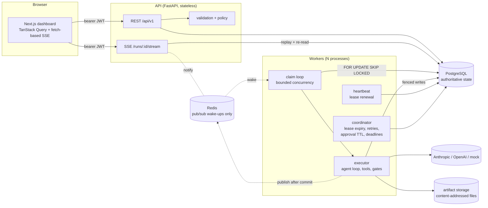
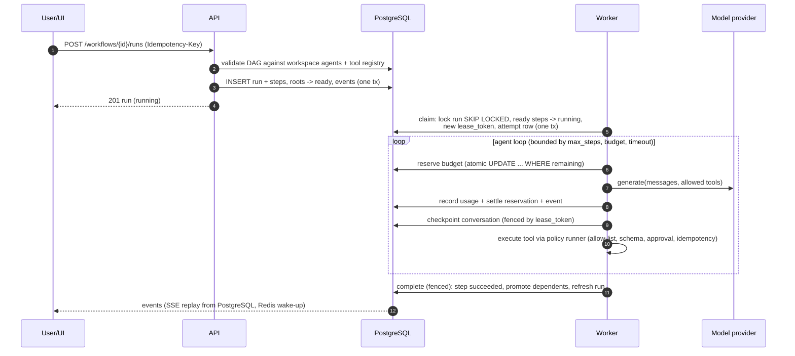

# Architecture

AgentOS is three processes around one source of truth:



* **PostgreSQL is authoritative.** Runs, steps, attempts, leases, tool executions,
  approvals, events, usage and artifact metadata all live there. Redis carries only
  "something changed" notifications. Every consumer re-reads PostgreSQL, so losing
  Redis costs latency (polling fallback), not correctness. This is tested in
  `test_works_without_redis`.
* **The API is stateless.** It validates and authorizes requests, creates runs
  transactionally, resolves approvals, and streams events.
* **Workers are symmetric.** Each one claims work, executes it, heartbeats, and also
  runs the coordinator duties. Those duties are idempotent and use `SKIP LOCKED`,
  so any number of workers can run them concurrently.

## Code layout

| Package | Contents |
|---|---|
| `packages/shared/agentos_core` | Settings, ORM models, DAG schema/validation, state machines, **engine** (`engine/core.py`: every state transition), events, pricing, redaction, storage, documents, **providers** (Anthropic, OpenAI, mock), **tools** (registry, runner, four tools), planner, demo seed data. |
| `apps/api/agentos` | FastAPI app, routers, request/response schemas, auth (dev JWT), rate limiting, idempotency keys, body-size limits, Alembic migrations. |
| `apps/worker/agentos_worker` | Process entrypoint, claim loop (`scheduler.py`), executor, agent runtime, budgeted model calls, heartbeat, recovery. |
| `apps/web` | Next.js App Router dashboard; typed client generated from the API's OpenAPI document. |

The spec placed providers and tools under the worker. They live in the shared core
because the API needs them too: the tool catalog for validation, and the provider
for synchronous planning. See ADR-003 in `ARCHITECTURE_DECISIONS.md`.

## Run lifecycle



## Approval flow

```mermaid
sequenceDiagram
    participant W as Worker (agent loop)
    participant P as PostgreSQL
    participant U as Reviewer
    W->>P: tool_execution(pending_approval, args_hash)
    W->>P: suspend (fenced): approval_request, step waiting_approval,<br/>lease cleared, conversation checkpoint
    U->>P: approve/reject (role >= developer, Idempotency-Key)
    P->>P: approval decided once; step -> ready
    W->>P: claim again (new attempt), resume from checkpoint
    alt approved
        W->>P: consume approval (UPDATE ... WHERE approved AND consumed_at IS NULL AND args_hash matches)
        W->>W: execute tool exactly as approved
    else rejected / expired
        W->>W: tool result "not approved, NOT executed" returned to the model
    end
```

## Crash recovery

```mermaid
sequenceDiagram
    participant W1 as Worker 1
    participant P as PostgreSQL
    participant W2 as Worker 2
    W1->>P: claim step (lease_token=T1, expires now+TTL)
    W1-xW1: process killed (no cleanup)
    Note over P: heartbeats stop, lease expires
    W2->>P: coordinator: running AND lease_expires_at < now()<br/>-> attempt lease_expired, step retry_wait (backoff)
    W2->>P: promote -> ready; claim (lease_token=T2)
    W2->>P: complete with T2 (succeeds)
    W1-->>P: a late write with T1 is rejected (StaleLeaseError, event step.stale_result_rejected)
```

## Concurrency control

* **Lock ordering.** Every transaction that changes a run's steps, events, approvals
  or counters locks the `workflow_runs` row first, then step rows. Claims take the
  run lock with `SKIP LOCKED`, so a busy run is skipped rather than waited on. The
  only exception is single-row lease renewal, which holds no other locks. Deadlocks
  and serialization failures are retried anyway (`run_in_transaction`).
* **Fencing.** Every completion, failure, suspension, checkpoint and side-effecting
  tool write checks `lease_token = :mine AND status = 'running'` inside the
  run-locked transaction.
* **Per-run event order.** Events are buffered during the transaction. At commit, a
  single `UPDATE ... event_seq = event_seq + n RETURNING` reserves a gap-free block
  of sequence numbers (the run lock is held), and the events are inserted in one
  batch. See `docs/benchmarks.md` for why.

## Observability

* Structured JSON logs (structlog) with a redaction processor and request ids.
* OpenTelemetry spans for HTTP (FastAPI instrumentation when enabled),
  `step.execute`, `model.call` (GenAI attributes: model, tokens, finish reason) and
  `tool.call`. Spans carry ids and counts, never prompt or document text. Trace ids
  are stored on events even without an exporter, so a failed step in the UI links to
  its trace. Export is OTLP/HTTP to the optional collector + Jaeger
  (`docker compose --profile observability up`).
* Metrics endpoints compute everything from persisted rows (`/api/v1/metrics/*`).
