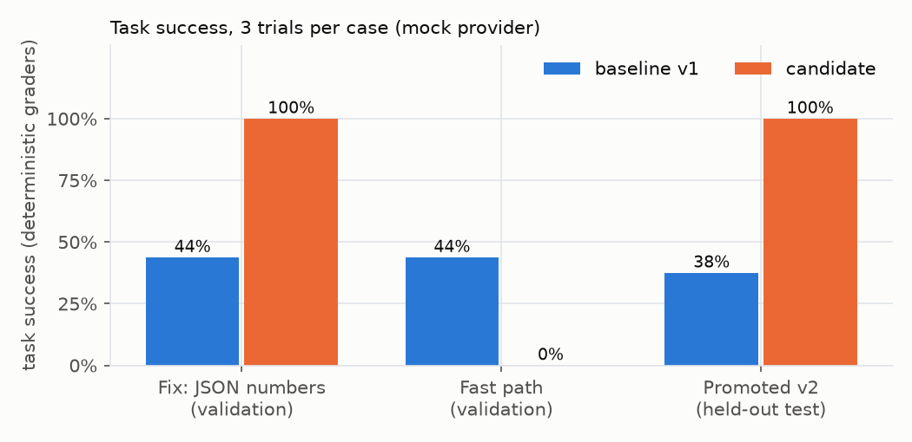
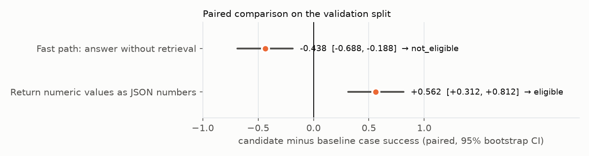
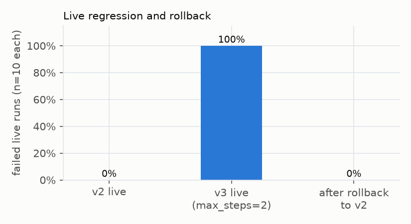
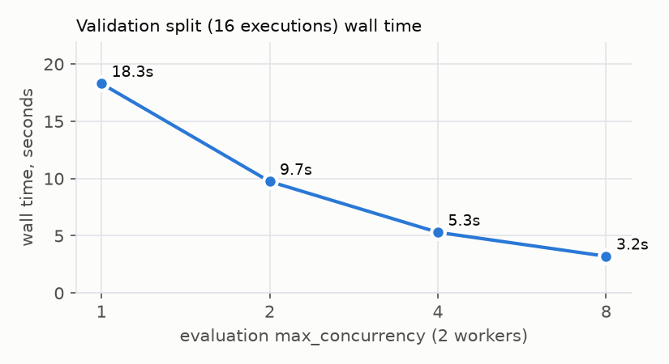

# Autopilot benchmark

_Generated by `benchmarks/autopilot_report.py` from `benchmarks/results/autopilot/`. Do not edit by hand._

## What this measures and what it does not

One full optimization cycle (observe → detect → diagnose → propose → experiment → gate → approve → deploy → monitor → rollback) on an isolated database with real worker processes, then an evaluation-concurrency scan. **The provider is the deterministic mock** (`mock-extractor`, scripted diagnosis and optimizer), so success rates describe the scripted demo agent's config-sensitive behavior, not a real model, and costs are simulated from the mock price table. What the numbers do show is that the pipeline measures, gates and rolls back correctly, and how long its own machinery takes.

Machine: Apple M1, 8 cores, 8.0 GB RAM, macOS-26.5.2-arm64-arm-64bit-Mach-O, Python 3.13.7, postgres (PostgreSQL) 16.15. Run started 2026-10-25T18:33:23-0700, took 114.0s. Trials per case: 3. Bootstrap: paired percentile, 10,000 resamples, seed 20261025.

## Reproduce

```bash
make up            # postgres + redis
uv run --group bench python benchmarks/autopilot_bench.py --label autopilot --trials 3
uv run --group bench python benchmarks/autopilot_report.py
```

## Baseline vs candidate



| arm | split | candidate | executions | task success | schema | grounding | tool correctness | cost / success | total cost | p50 ms | p95 ms |
|---|---|---|---|---|---|---|---|---|---|---|---|
| baseline v1 | validation | Return numeric values as JSON numbers | 48 | 43.8% (21/48) | 43.8% | 43.8% | 100.0% | $0.00699 | $0.14686 | 357 | 580 |
| candidate v2 | validation | Return numeric values as JSON numbers | 48 | 100.0% (48/48) | 100.0% | 100.0% | 100.0% | $0.00215 | $0.10301 | 342 | 537 |
| baseline v1 | validation | Fast path: answer without retrieval | 48 | 43.8% (21/48) | 43.8% | 43.8% | 100.0% | $0.00699 | $0.14686 | 316 | 432 |
| candidate v3 | validation | Fast path: answer without retrieval | 48 | 0.0% (0/48) | 0.0% | 0.0% | 0.0% | undefined (0 successes) | $0.02609 | 188 | 265 |
| baseline v1 | test | — | 24 | 37.5% (9/24) | 37.5% | 37.5% | 100.0% | $0.00841 | $0.07571 | 347 | 457 |
| promoted v2 | test | — | 24 | 100.0% (24/24) | 100.0% | 100.0% | 100.0% | $0.00214 | $0.05128 | 303 | 345 |

Baseline rows are separate executions per experiment (each experiment runs both arms interleaved), so baseline latency differs slightly between rows. The held-out test split was evaluated only after selection, and was never shown to the optimizer.

## Paired comparison and gate decisions



| candidate | decision | matched cases | regressed cases | per-case regression rate | mean diff | 95% CI |
|---|---|---|---|---|---|---|
| Return numeric values as JSON numbers | eligible | 16 | 0 | 0.0% | +0.5625 | [+0.3125, +0.8125] |
| Fast path: answer without retrieval | not_eligible | 16 | 7 | 43.8% | -0.4375 | [-0.6875, -0.1875] |

Candidates generated: 3. Rejected by policy before any evaluation: 1 (“Persist extractions as artifacts”: allowed_tool_ids: adds tools not in the agent's approved allowlist: ['artifact_writer']). Evaluated: “Return numeric values as JSON numbers” → eligible, “Fast path: answer without retrieval” → not_eligible. The fast-path candidate is 5.6x cheaper in total but fails every case, so its cost per successful task is undefined, not low, and it is refused.

## Live regression and rollback



| phase | failed live runs |
|---|---|
| v2 (promoted fix) | 0.0% |
| v3 (max_steps=2, passed offline gates: eligible) | 100.0% |
| after admin rollback to v2 | 0.0% |

10 runs per phase of the two-subject live workflow. The step cap passed the single-subject validation set but breaks the two-subject live workflow, which is the case offline evaluation can miss and monitoring exists for. Rollback is manual (auto-rollback is off by default) and applies to new runs only.

## Optimization overhead

| phase | seconds |
|---|---|
| observe_dev_benchmark | 2.947 |
| detect_failures | 0.069 |
| diagnose | 0.072 |
| generate_candidates | 0.098 |
| experiment_Return numeric val | 15.174 |
| experiment_Fast path: answer  | 15.383 |
| promote | 0.062 |
| regression_detection_after_deploy | 1.112 |

Simulated Autopilot LLM spend for the cycle (diagnosis + optimizer): $0.005608. Diagnosis and candidate generation take milliseconds with the mock provider; with a real provider they are dominated by model latency, which this benchmark does not measure. Experiment time is dominated by running 2 arms x 16 cases x 3 trials = 96 real workflow runs.

## Evaluation throughput vs concurrency



| max_concurrency | executions | wall s | executions / s |
|---|---|---|---|
| 1 | 16 | 18.298 | 0.87 |
| 2 | 16 | 9.743 | 1.64 |
| 4 | 16 | 5.302 | 3.02 |
| 8 | 16 | 3.211 | 4.98 |
