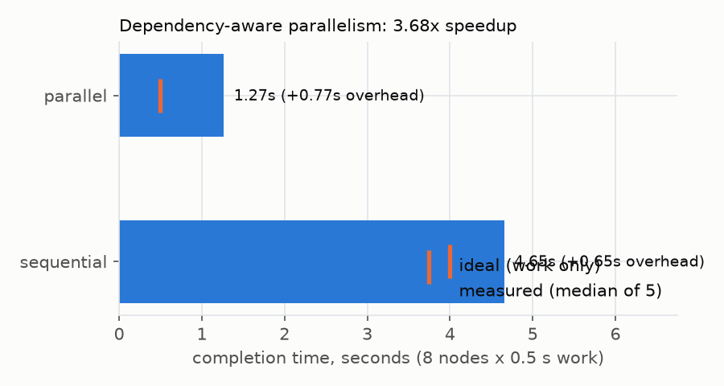
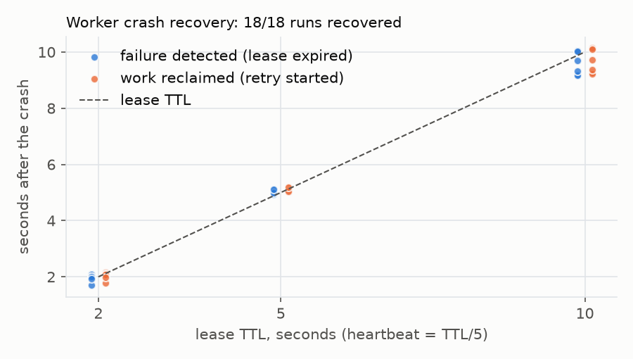
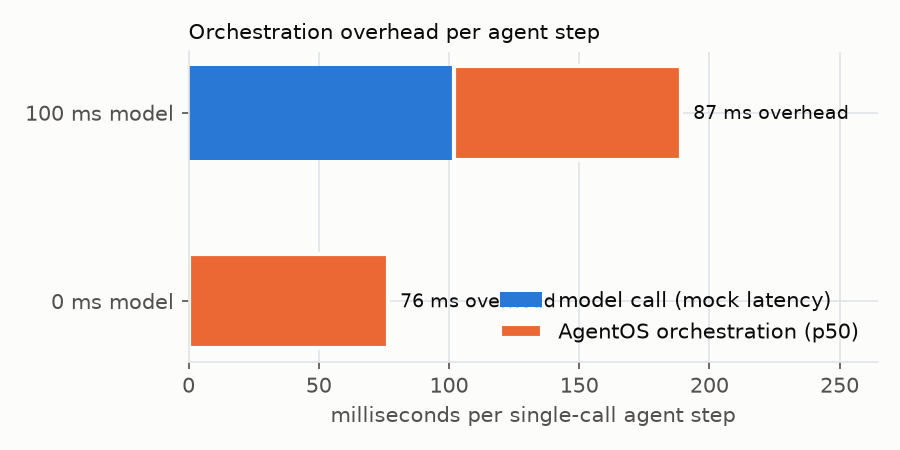
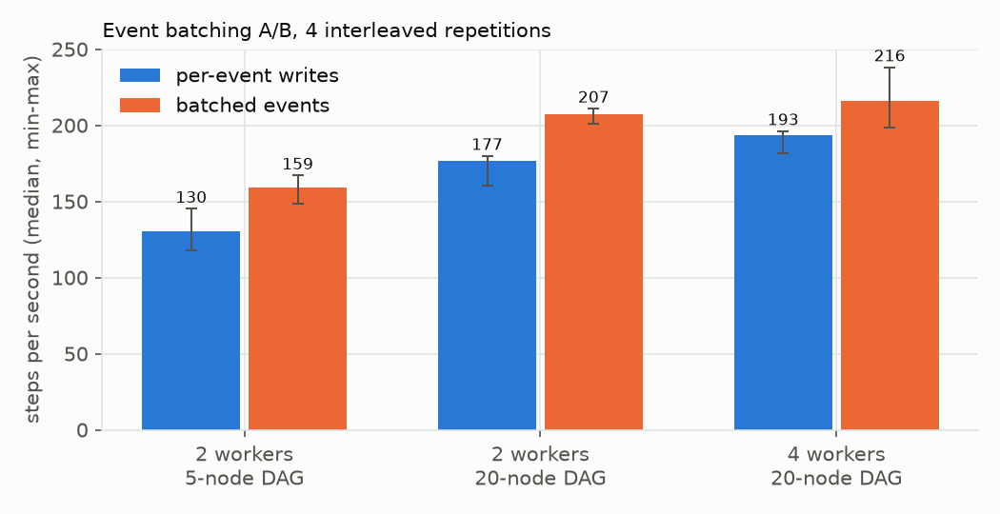

# Benchmarks

Every number below was measured on the machine stated, with the scripts in
`benchmarks/`. The tables are generated from `benchmarks/results/*/` CSVs by
`benchmarks/report.py`, not typed by hand. These are local, single-machine numbers
on Docker Desktop for macOS: they show relative behavior and orders of magnitude,
not production capacity.

## Methodology

* **Isolation.** A dedicated database (`agentos_bench`) is recreated and migrated,
  then truncated and re-seeded before every configuration.
* **Real processes.** Workers are separate `agentos-worker` OS processes, not
  in-process tasks. The crash benchmark kills them with `os._exit(137)`.
* **Measured from the database.** Throughput, latencies and recovery times come from
  timestamps the engine persists (`step_attempts.started_at/finished_at`,
  `queue_wait_ms`, run timestamps). CPU and RSS are psutil samples of the worker
  processes, summed. "Lock-wait share" is the fraction of active AgentOS backends
  in `pg_stat_activity` waiting on a lock, sampled every ~250 ms.
* **Workloads are deterministic.** No model inference: `aggregation` nodes (no-op
  work), `agent` nodes using the mock provider (one model call, full agent path:
  budget reservation, usage accounting, checkpoints, events), and injected sleeps
  for known work.

| Benchmark | Workload | Measures |
|---|---|---|
| 1 Throughput | 40 workflows of a fan-out DAG (root -> N-2 parallel -> sink), backlog pre-filled before workers start | steps/s, workflows/min, start latency (ready -> claimed, non-root steps), execution overhead (claim -> recorded completion), lock waits, CPU, memory |
| 2 Parallel vs sequential | 8 independent nodes x 0.5 s + sink; `max_concurrency` 1 vs 8; 2 workers x 4; 5 reps | completion time vs ideal |
| 3 Recovery | 3-node chain; the middle node's worker is killed 1.0 s into attempt 1; supervised restart; 6 crashes per lease TTL | detection (crash -> attempt marked `lease_expired`), reclaim (crash -> retry started), duplicates, re-execution of completed steps |
| 4 Overhead | 30 sequential single-node runs of a one-call agent; mock latency 0 and 100 ms | step execution minus direct provider call |

Reproduce:

```bash
docker compose up -d postgres redis
make bench LABEL=mine     # ~5 minutes; writes benchmarks/results/mine/
make bench-plot           # charts in docs/benchmarks/
uv run --group bench python benchmarks/report.py   # tables (reads baseline/optimized/ab)
```

## Results

Machine: Apple M1, 8 cores, 8.0 GB RAM, macOS-26.5.2-arm64-arm-64bit-Mach-O, Python 3.13.7, postgres (PostgreSQL) 16.15 in Docker Desktop. Run started 2026-10-25T06:10:59-0700.

### Benchmark 1 - scheduling throughput (40 workflows, pre-filled backlog, single trial)

| nodes | DAG size | workers | conc. | steps/s (baseline) | steps/s | workflows/min | start p50 ms | start p95 ms | exec p50 ms | exec p95 ms | lock-wait share | worker CPU % (sum) | worker RSS MB (sum) |
|---:|---:|---:|---:|---:|---:|---:|---:|---:|---:|---:|---:|---:|---:|
| aggregation | 5 | 1 | 4 | 104.9 | 113.6 | 1362.9 | 626.5 | 918.3 | 21.6 | 46.6 | 0.0 | 63.6 | 84.0 |
| aggregation | 5 | 1 | 8 | 103.9 | 131.4 | 1577.0 | 516.0 | 718.8 | 37.4 | 64.1 | 0.231 | 67.9 | 84.9 |
| aggregation | 5 | 2 | 4 | 127.5 | 155.2 | 1862.3 | 417.0 | 655.1 | 29.9 | 51.1 | 0.0 | 125.8 | 165.3 |
| aggregation | 5 | 2 | 8 | 155.3 | 165.8 | 1989.9 | 368.5 | 547.0 | 54.4 | 153.4 | 1.0 | 124.0 | 164.0 |
| aggregation | 5 | 4 | 4 | 137.2 | 128.5 | 1542.1 | 394.0 | 787.2 | 64.0 | 191.2 | 0.318 | 195.0 | 324.6 |
| aggregation | 5 | 4 | 8 | 162.0 | 154.5 | 1854.2 | 288.0 | 413.0 | 100.1 | 437.2 | 0.5 | 218.2 | 328.0 |
| aggregation | 20 | 1 | 4 | 81.7 | 118.4 | 355.1 | 3270.0 | 5586.0 | 21.5 | 36.1 | 0.538 | 66.3 | 84.3 |
| aggregation | 20 | 1 | 8 | 95.6 | 149.1 | 447.3 | 2398.0 | 4279.1 | 33.4 | 63.7 | 0.725 | 71.0 | 83.7 |
| aggregation | 20 | 2 | 4 | 124.6 | 167.4 | 502.1 | 2156.0 | 3885.0 | 29.8 | 48.5 | 0.429 | 117.4 | 164.0 |
| aggregation | 20 | 2 | 8 | 162.9 | 207.4 | 622.2 | 1693.0 | 2999.7 | 49.6 | 91.4 | 0.789 | 127.3 | 165.0 |
| aggregation | 20 | 4 | 4 | 153.2 | 197.4 | 592.2 | 1776.0 | 3211.2 | 49.8 | 87.8 | 0.551 | 209.8 | 326.0 |
| aggregation | 20 | 4 | 8 | 125.1 | 222.0 | 666.1 | 1409.0 | 2701.0 | 88.5 | 185.5 | 0.721 | 213.8 | 329.2 |
| agent | 5 | 1 | 8 | 67.3 | 71.3 | 855.8 | 992.5 | 1475.4 | 83.4 | 145.2 | 0.5 | 80.0 | 83.5 |
| agent | 5 | 2 | 8 | 87.5 | 91.7 | 1100.1 | 685.0 | 1037.0 | 128.6 | 234.7 | 0.45 | 138.9 | 165.1 |
| agent | 5 | 4 | 8 | 87.0 | 110.6 | 1327.7 | 418.0 | 699.0 | 196.7 | 456.6 | 0.477 | 240.7 | 327.4 |

### Optimization A/B - event batching (interleaved repetitions, same code and session)

| workers | DAG size | reps | per-event writes: steps/s median (min-max) | batched: steps/s median (min-max) | median change | exec p50 ms |
|---:|---:|---:|---:|---:|---:|---:|
| 2 | 5 | 4 | 130.1 (117.6-145.3) | 158.8 (148.8-167.2) | +22.1% | 64.2 -> 55.8 |
| 2 | 20 | 4 | 176.6 (160.4-180.0) | 207.2 (201.3-211.1) | +17.4% | 54.1 -> 49.4 |
| 4 | 20 | 4 | 193.3 (181.8-196.3) | 215.8 (198.6-238.2) | +11.6% | 92.8 -> 90.8 |

### Benchmark 2 - parallel vs sequential (8 independent nodes x 0.5 s + sink)

| mode | reps | completion s (median) | range | ideal s | overhead s |
|---:|---:|---:|---:|---:|---:|
| sequential | 5 | 4.653 | 4.584-4.686 | 4.0 | 0.653 |
| parallel | 5 | 1.266 | 1.218-1.284 | 0.5 | 0.766 |

Measured speedup: **3.68x** (ideal 8x; the gap is per-step scheduling overhead, see Benchmark 1).

### Benchmark 3 - failure recovery (worker process killed mid-step)

| lease TTL s | heartbeat s | crashes | recovered | detection s median (range) | reclaim s median (range) | duplicate attempts | completed-step re-executions |
|---:|---:|---:|---:|---:|---:|---:|---:|
| 2.0 | 0.4 | 6 | 6/6 | 2.00 (1.70-2.11) | 2.09 (1.79-2.17) | 0 | 0 |
| 5.0 | 1.0 | 6 | 6/6 | 5.05 (4.95-5.12) | 5.11 (5.03-5.18) | 0 | 0 |
| 10.0 | 2.0 | 6 | 6/6 | 9.51 (9.17-10.04) | 9.56 (9.23-10.14) | 0 | 0 |

### Benchmark 4 - orchestration overhead (single-call agent step, mock provider)

| mock latency ms | samples | direct provider call ms | step exec p50 ms | step exec p95 ms | run end-to-end p50 ms | AgentOS overhead p50 ms |
|---:|---:|---:|---:|---:|---:|---:|
| 0 | 30 | 0.02 | 76.4 | 106.2 | 107.1 | 76.4 |
| 100 | 30 | 101.96 | 189.0 | 220.5 | 216.9 | 87.0 |






## Bottleneck found and optimization applied

**Observation (baseline).** On the 20-node fan-out DAG, 79–91% of active database
backends were waiting on a lock, and adding workers stopped helping: 4 workers x 8
ran *slower* than 2 x 8 (125 vs 163 steps/s). Sampling `pg_stat_activity` during a
4-worker run showed 785 of 787 lock waits were the run-row
`SELECT ... FOR UPDATE`. The run lock is the engine's serialization point by design:
it orders events and keeps step transitions consistent. So the cost was how long
each transaction held it. The worker-row counter update I suspected first accounted
for 1 sample.

**Change.**
1. Events are buffered during the transaction and written at commit with one
   `UPDATE ... event_seq = event_seq + n RETURNING` plus one batched insert. Before,
   each event cost an `UPDATE` and an `INSERT` round trip while the run lock was held.
   Order and gap-freedom are unchanged, because the block is reserved under the same
   lock.
2. The per-worker completed-step counter moved from every completion transaction
   into the heartbeat.
3. Fenced writes reuse the claim's `run_id` instead of looking it up.

**Evidence.** The A/B table isolates change 1 (`AGENTOS_EVENT_BATCHING`): same code,
same session, interleaved repetitions. Median throughput rose 11.6–22.1%, and in all
three configurations the slowest batched run beat the fastest unbatched run. The
baseline -> optimized columns in Benchmark 1 include all three changes. Those are
single trials, so small differences (especially on the 1–2 s 5-node runs) are noise;
the 20-node configurations improved 27–78%.



## Interpretation and limitations

* **Throughput ceiling.** Roughly 150–220 no-op steps/s on this laptop. The limits
  are the per-run lock and Python CPU in the workers: about 65% of a core per worker
  process at saturation. Real agent steps are dominated by model latency (seconds),
  so this ceiling corresponds to hundreds of concurrent agent steps.
* **Start latency in Benchmark 1** is mostly queueing behind a pre-filled backlog, not
  dispatch delay. In Benchmark 2 the per-step dispatch overhead is about 80 ms.
* **Parallel speedup** is 3.68x against an ideal 8x for 0.5 s steps, because each
  step pays tens of milliseconds of claim and complete transactions. Longer steps
  approach the ideal.
* **Recovery time is set by the lease TTL.** Detection lands between about 0.8x TTL
  and TTL plus one coordinator tick: the lease was last renewed up to one heartbeat
  interval before the crash. Lowering the TTL trades faster recovery for more
  heartbeat writes and a higher risk of reclaiming slow but healthy steps.
* **Orchestration overhead** is about 76–87 ms per single-call agent step: budget
  reservation, two events, usage record, checkpoint, completion. That is negligible
  next to real model calls (typically 1–30 s), and it was not the target of the
  optimization (no statistically meaningful change).
* Docker Desktop's VM networking and filesystem add latency compared with a Linux
  host. Results from a single machine say nothing about multi-node PostgreSQL
  deployments.
