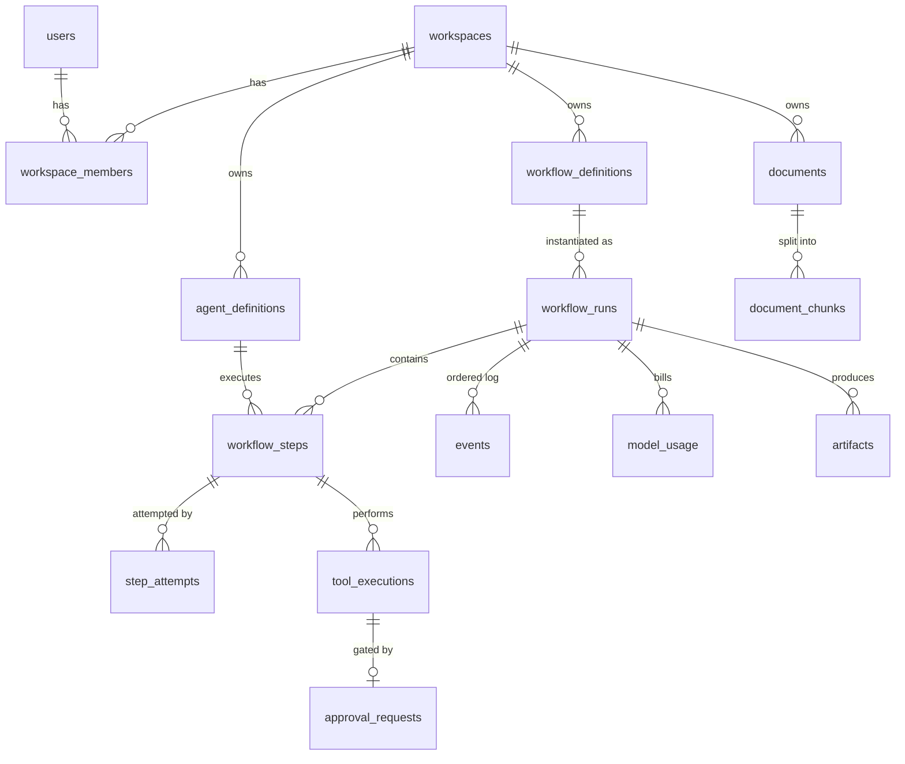
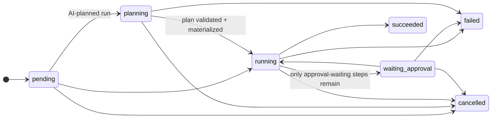
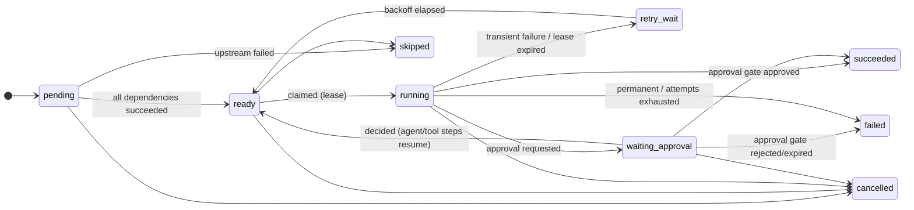

# Data model

PostgreSQL 16, one Alembic migration (`apps/api/alembic/versions/20261025_0001_initial_schema.py`).
CI checks upgrade, downgrade, and that the models and migration don't drift
(`alembic check`). All timestamps are `timestamptz` (UTC).

| Table | Purpose | Key constraints / indexes |
|---|---|---|
| `users` | dev-auth identities (scrypt hashes) | `email` unique |
| `workspaces`, `workspace_members` | tenancy; role in (`admin`, `developer`, `viewer`) | PK (`workspace_id`, `user_id`), role check |
| `agent_definitions` | provider, model, instructions, allowed tools, limits | unique (`workspace_id`, `name`); checks on provider, `max_steps` 1–50, timeout, cost ≥ 0 |
| `workflow_definitions` | **immutable** DAG JSON per version | unique (`workspace_id`, `name`, `version`) |
| `workflow_runs` | status, input/output/error, budget snapshot, live counters (`model_calls`, `tool_calls`, `cost_reserved_usd`, `cost_spent_usd`), `event_seq`, `deadline_at` | status check; indexes on (`workspace_id`, `created_at`), `status` |
| `workflow_steps` | one row per DAG node per run; lease (`lease_owner`, `lease_token`, `lease_expires_at`), `attempt_count`, `failure_count`, `next_run_at`, `checkpoint` | unique (`run_id`, `node_key`); **check `(status='running') = (lease_token IS NOT NULL)`**; partial indexes for claimable steps and for running leases |
| `step_attempts` | immutable attempt history: worker, lease token, queue wait, status, error | unique (`step_id`, `attempt_number`), unique `lease_token` |
| `tool_executions` | every tool request (including denied), redacted args/result, `arguments_hash`, `idempotency_key` | **partial unique (`idempotency_key`) where `status='succeeded'`** |
| `approval_requests` | action, sanitized args, `arguments_hash`, TTL, decision, `consumed_at` | unique `tool_execution_id`; **partial unique (`step_id`) where `status='pending'`** |
| `events` | per-run ordered audit and stream log | **unique (`run_id`, `sequence_number`)** |
| `model_usage` | one row per call; `NULL` token counts mean "not reported"; `cost_basis` in (actual, partial, simulated, unknown); `pricing_version` | indexes on run, time, agent |
| `artifacts` | metadata (content on disk, content-addressed) | **unique (`run_id`, `idempotency_key`)**, unique (`run_id`, `filename`) |
| `documents`, `document_chunks` | untrusted sources; `search_vector` is a generated `tsvector` column | GIN index on `search_vector` |
| `workers` | heartbeat registry (status, in-flight, completed count) | index on `last_heartbeat_at` |
| `idempotency_records` | `Idempotency-Key` responses for run creation and approval decisions | unique (`workspace`, `user`, `scope`, `key`) |

**Deletion behavior.** Agent and workflow definitions are `RESTRICT`ed, so history
never loses its referents. Run-owned audit rows cascade from the run, and nothing
deletes runs in normal operation.

## State machines

All transitions are defined once in `agentos_core/domain/states.py` and asserted at
every write.

Approvals: `pending -> approved | rejected | expired`, all terminal, plus single-use
`consumed_at`.
