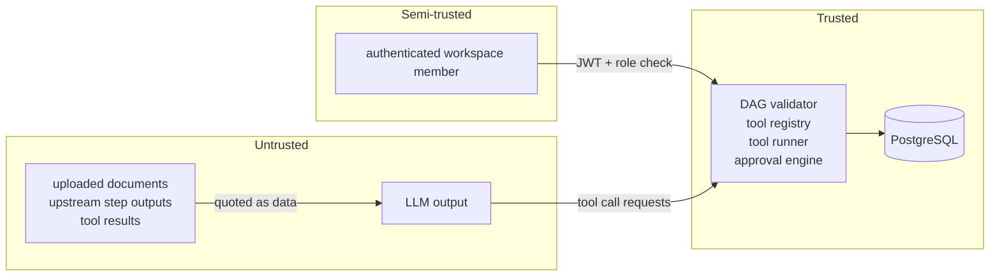

# Security model

AgentOS treats **model output as untrusted input**. A model can *ask* for anything.
What actually happens is decided by code paths that do not consult the model.

## Trust boundaries

| Boundary | Control (in code) | Where |
|---|---|---|
| Browser -> API | Bearer JWT (HS256), expiry, issuer; every resource endpoint resolves the caller's workspace membership | `agentos/dependencies.py` |
| Workspace isolation | All queries filter by the caller's `workspace_id`. Foreign ids return 404, not 403, so existence isn't revealed | routers; `test_workspace_isolation` |
| Roles | `viewer` read-only; `developer` creates and runs workflows and decides approvals; `admin` also edits workspace settings | `WorkspaceContext.require`; `test_role_enforcement` |
| Model -> tools | Effective tools = agent allow-list ∩ node `tools` ∩ registry. Anything else is recorded as `denied` and never executed. Three denials fail the step | `tools/runner.py`; `test_invalid_tool_arguments_are_reported_not_executed` |
| Planner -> DAG | AI plans go through the same `validate_definition` (cycles, unknown agents/tools, unauthorized tools, node/budget limits). A plan may tighten budgets, never loosen them | `planner.py`, `complete_planner_step`; `test_planner_cannot_grant_unauthorized_tools` |
| Documents -> model | Content is wrapped in `<task_input>` and the platform rules say it is data. **This is defense in depth, not the control**: the tool policy above holds even when the model obeys an injection | `test_prompt_injection_in_documents_cannot_grant_tools` |
| Side effects | `artifact_writer` requires approval. Approval is bound to the tool-execution id and the SHA-256 of the canonical arguments, is single-use (`consumed_at`), and expires (24 h default) | `engine/core.py` `consume_approval`; `test_approval_is_bound_to_arguments_and_single_use` |
| Files | One storage root; paths resolved and checked to stay inside it; filenames `^[A-Za-z0-9][A-Za-z0-9._-]{0,120}$`; content-addressed; atomic writes; data reader limited to this workspace's documents/artifacts plus a size cap | `storage.py`; `test_filename_validation_blocks_traversal`, `test_data_reader_is_confined_to_workspace` |
| Downloads | `Content-Disposition: attachment`, `X-Content-Type-Options: nosniff`, `CSP: default-src 'none'`; previews are always `text/plain` | `api/artifacts.py` |
| Abuse | Request body cap (1 MB, 10 MB uploads), enforced on streamed bodies too; Redis fixed-window rate limits on login, run creation, planning, approvals and uploads (per-process fallback if Redis is down) | `observability/middleware.py`, `security/rate_limit.py` |
| Secrets | Provider keys are read server-side only; `/api/v1/system` reports only whether a key is configured. Logs, events, tool arguments/results and approval payloads go through `redact()` (key-like field names plus `sk-…`, AWS keys, bearer tokens, DSN passwords) | `redaction.py`; `test_redaction`, `test_system_info_never_leaks_secrets` |
| Production safety | `AGENTOS_ENVIRONMENT=production` refuses to start with the dev JWT secret, a secret shorter than 32 bytes, dev login, or fault injection enabled | `Settings.ensure_safe`; `test_production_refuses_dev_defaults` |

## Not provided in v1

* **No shell or code-execution tool.** No arbitrary filesystem access.
* **No HTTP fetch tool.** It is intentionally not registered. Shipping it safely needs
  an allowlist, DNS-resolution checks against private/loopback/link-local/metadata
  ranges, redirect revalidation and response caps. That was deferred rather than
  shipped half-done.

## Development authentication: limitations

* Seeded users with known passwords. The login endpoint is disabled when
  `AGENTOS_DEV_AUTH_ENABLED=false`.
* Tokens are stored in `localStorage` (readable by any XSS in the origin). There is
  no refresh, no revocation list, and no MFA. Use a real identity provider (OIDC)
  for anything beyond local use.
* HS256 with a shared secret. There is no key rotation.

## Data retention and privacy

* Agent conversations (the checkpoint) are stored on the step while it runs and
  **cleared when the step completes**. Model response previews (first 2,000
  characters, redacted) are kept in events for inspection. Full prompts are not
  retained after success.
* OpenAI requests use `store=false`. Anthropic requests are sent with the configured
  model, and the server-side refusal fallback is enabled on supported models (see
  `providers/anthropic.py`).
* Spans exported to OpenTelemetry contain ids, counts and model names, never content.
  The bundled collector config also deletes common content attributes.

## Known risks

* A rejected action is reported back to the model, which may try again. Each new
  request needs a new approval, and `max_steps` bounds the loop. There is no
  per-reviewer "deny forever" rule yet.
* Rate limits are keyed per token suffix and endpoint path, not per user id.
* The mock provider's scenarios are code, not a model. Prompt-injection resistance is
  therefore demonstrated against a deliberately gullible scripted policy, not against
  a real model.
